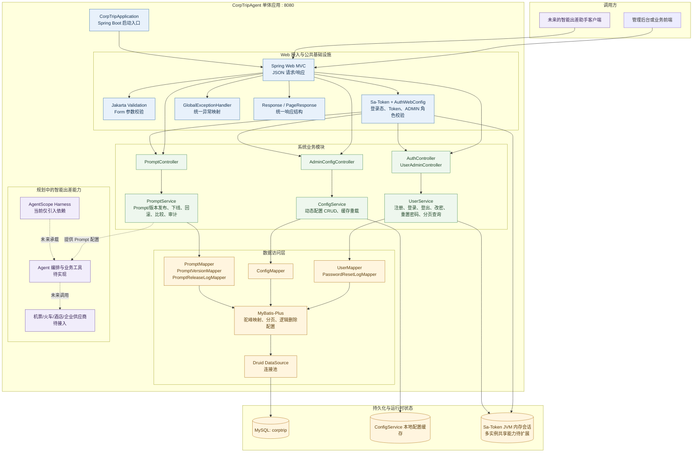

# CorpTripAgent 项目整体架构

## 1. 项目定位

CorpTripAgent 当前是一个基于 Spring Boot 的企业内部智能出差助手后端项目，采用单模块 Maven 工程。现有代码主要承载后台基础能力：用户注册、登录、会话与角色控制，系统动态配置管理，以及 Agent Prompt 的定义、版本、发布、下线、回滚和发布审计。

项目设计文档中规划的出差申请、政策校验、行程规划、资源预订和报销闭环属于产品目标；从当前源码看，这些业务能力尚未形成独立的 Controller、Service 和数据表模块。AgentScope Harness 已作为依赖引入，但当前代码中尚未看到独立的 Agent 编排、工具适配器或外部机票/酒店供应商实现。

## 2. 总体架构图

## 3. 分层说明

### 调用与 Web 接入层

客户端通过 HTTP 调用 Spring Web MVC 接口。Controller 只负责接收请求、触发参数校验和返回 `Response` 或 `PageResponse`。当前接口主要分为四组：

- `/auth`：注册、登录、登出、当前用户信息和修改密码。
- `/system/user`：管理员分页查询用户、重置用户密码。
- `/config`：管理员查询、新增、更新、删除和重载动态配置。
- `/system/prompt`：管理员管理 Prompt、版本和发布审计记录。

### 认证与公共基础设施

`AuthWebConfig` 注册 Sa-Token 拦截器和自定义请求拦截器。除注册、登录和预检请求外，接口默认要求登录；`/config`、`/system/user` 和 `/system/prompt` 管理路径还要求 `ADMIN` 角色。用户修改密码或管理员重置密码后，`credential_version` 会变化，旧 Token 会失效。

`GlobalExceptionHandler` 将业务异常、未登录、无权限、参数校验失败和未预期异常统一转换为 HTTP 状态码及 `Response` 结构。`CurrentUser` 负责从当前 Sa-Token 会话中解析用户，并再次校验数据库中的凭据版本。

### 业务服务层

- `UserService`：使用 BCrypt 保存密码，负责账户生命周期、会话登录/注销、密码变更、管理员重置密码和重置审计记录。
- `ConfigService`：管理 `t_config` 中的字符串配置值，并维护服务内配置缓存；配置值的具体类型由业务读取方解释。
- `PromptService`：维护 Prompt 主定义和递增版本，计算内容 SHA-256，执行发布、下线、回滚等状态变更，并将操作结果写入发布日志。

### 数据访问与存储层

业务服务通过 MyBatis-Plus Mapper 访问 MySQL，Druid 提供连接池。项目开启下划线到驼峰映射和逻辑删除配置。主要数据表如下：

| 领域 | 数据表 | 作用 |
| --- | --- | --- |
| 配置 | `t_config` | 动态配置名称、Key、字符串值和备注 |
| 用户 | `t_user` | 用户账号、BCrypt 密码摘要、角色和凭据版本 |
| 用户审计 | `t_user_password_reset_log` | 管理员重置密码的原因与操作人 |
| Prompt | `t_prompt` | Prompt 定义、所属 Agent 能力和当前生效版本 |
| Prompt 版本 | `t_prompt_version` | Prompt 正文、版本号、摘要和发布状态 |
| Prompt 审计 | `t_prompt_release_log` | 发布、下线、回滚的前后版本及结果 |

### 智能 Agent 扩展边界

产品设计文档定义了自然语言出差助手和企业差旅闭环，但当前实现还处于基础平台阶段。`AgentScope Harness` 已在 `pom.xml` 中声明，后续可在其上补充 Agent 编排层、差旅政策服务、供应商工具和人工确认节点；Prompt 管理模块可以为该编排层提供可发布、可回滚的提示词配置。

## 4. 典型请求链路

以管理员发布 Prompt 版本为例，请求流程大致为：

1. 管理后台向 `POST /system/prompt/{promptId}/versions/{versionId}/publish` 发送请求。
2. Sa-Token 检查登录态，`AuthWebConfig` 检查 `ADMIN` 角色，Spring Validation 校验请求体。
3. `PromptController` 将请求交给 `PromptService`。
4. `PromptService` 在事务中锁定 Prompt，检查版本状态和操作原因，更新当前版本及旧版本状态。
5. 服务写入 `t_prompt_release_log`，Mapper 通过 MyBatis-Plus、Druid 将变更提交到 MySQL。
6. Controller 返回统一的 `Response<PromptVersionVO>`；异常由 `GlobalExceptionHandler` 转换为统一错误响应。

以登录为例，`AuthController` 调用 `UserService` 查询用户、用 BCrypt 校验密码，然后由 Sa-Token 创建会话并把凭据版本写入 Token Session，最后返回 Token 和用户概要信息。

## 5. 当前边界与后续扩展

当前应用是单体部署形态，认证会话默认保存在 JVM 内存中；如果扩展为多实例部署，需要为 Sa-Token 接入 Redis 等共享存储。动态配置缓存目前也是单机缓存，多实例实时同步需要额外的发布订阅或统一配置中心。

当前代码没有直接暴露数据库 Entity，接口使用 Form、VO 和统一响应对象，符合现有分层约定。后续新增出差业务时，建议沿用 `Controller -> Service -> Mapper -> Entity` 的结构，并把外部供应商调用、政策校验、预算检查和需要用户确认的动作放在明确的业务服务或工具边界内。

## 6. 主要技术组件

Java 21、Spring Boot 3.5.6、Spring Web、Spring Validation、MyBatis-Plus 3.5.9、MySQL Connector/J、Druid 1.2.23、Fastjson2、Lombok、Sa-Token 1.39.0、Spring Security Crypto，以及 AgentScope Harness 2.0.3。

