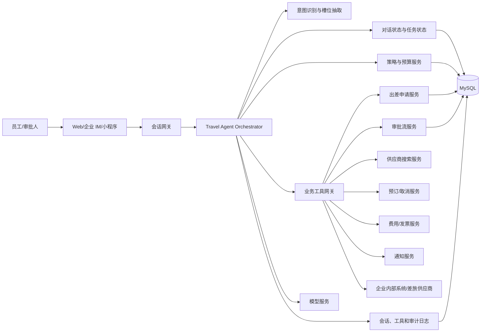
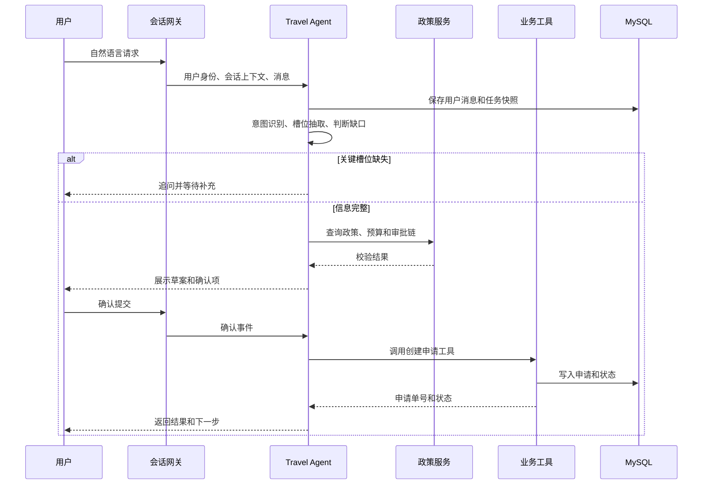
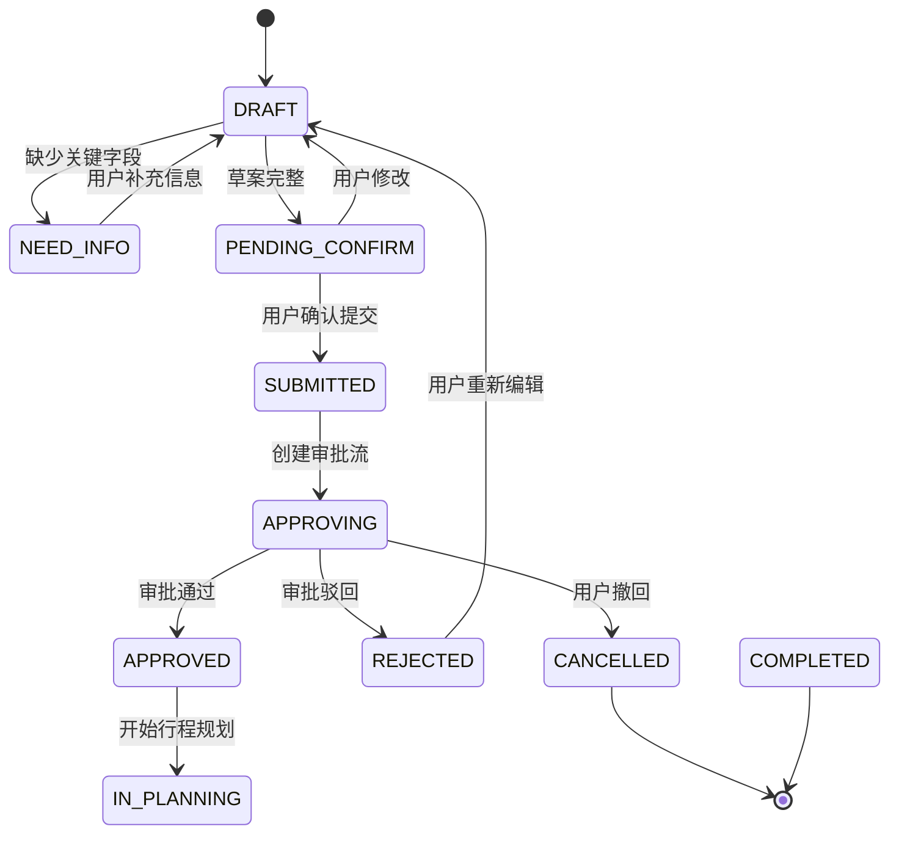

# 企业智能差旅助手 Agent 设计文档

## 1. 文档信息

| 项目 | 内容 |
| --- | --- |
| 文档名称 | 企业智能差旅助手 Agent 设计文档 |
| 适用项目 | CorpTripAgent |
| 文档版本 | v1.0 |
| 编写日期 | 2026-10-08 |
| 目标读者 | 产品、后端、Agent、前端、测试和运维人员 |
| 当前后端技术 | Java 21、Spring Boot 3.5.6、MyBatis-Plus 3.5.9、MySQL、Druid、Fastjson2、AgentScope Harness |

本文档用于指导企业内部智能差旅助手的产品设计、领域建模和后续开发。方案以“用户使用自然语言发起请求，系统通过 Agent 协调企业差旅规则和业务工具完成闭环”为核心，同时保留关键节点的人审、确认和审计能力。

## 2. 项目目标

### 2.1 业务目标

用户可以直接说：

> 下周一从上海去深圳拜访客户，周三晚上回来，帮我订机票和酒店并发起出差审批。

系统应当能够：

1. 识别出差人的身份、出发地、目的地、时间、事由和交通住宿需求。
2. 对缺少或有歧义的信息进行追问，而不是猜测关键业务事实。
3. 根据员工、部门、职级、预算、目的地和时间读取差旅政策。
4. 生成结构化出差申请单和行程草案。
5. 让用户确认关键内容后发起审批。
6. 在审批通过后搜索可用航班、火车、酒店或企业供应商资源。
7. 预订前展示价格、退改规则和预算占用，取得用户确认后执行预订。
8. 在行程期间提供提醒、变更和异常处理。
9. 出差结束后完成行程归档、发票收集、费用关联和报销准备。

### 2.2 产品边界

第一阶段聚焦企业内部差旅闭环：出差申请、审批、行程规划、预订确认、行程提醒、出差结束和报销材料归档。

以下能力暂不作为第一阶段强制范围：

- 自动替用户绕过审批或企业预算限制。
- 未经确认直接购买不可撤销的机票、火车票或酒店订单。
- 自动识别所有供应商的非标准页面并模拟人工操作。
- 代替财务完成最终报销审核。
- 复杂的跨法人、跨币种、跨国家税务处理。

## 3. 设计原则

### 3.1 Agent 负责理解和编排，业务服务负责决策和落库

大模型负责自然语言理解、信息提取、对话组织、候选方案解释和工具编排。审批规则、预算校验、权限校验、价格计算、状态流转和最终写库必须由确定性的业务服务完成。

### 3.2 关键动作必须可确认、可追踪、可回放

以下动作属于高风险动作，默认必须取得用户确认或符合企业授权策略后执行：

- 提交出差审批。
- 占用预算。
- 创建、修改或取消订单。
- 产生实际支付。
- 提交费用或报销材料。
- 代表用户向外部供应商发送信息。

每次 Agent 调用工具都要保存会话、工具名称、输入摘要、输出摘要、调用人、结果、耗时和关联业务单号。

### 3.3 缺失信息要追问，低风险信息可提供候选

出发地、目的地、出发和返回时间、出差人、出差事由等信息缺失时必须追问。座位偏好、酒店品牌、早餐等非必要信息可以采用企业默认偏好，并在确认卡中展示。

### 3.4 数据和权限最小化

Agent 只接收完成当前任务所需的数据。工具层必须再次校验当前用户、所属部门、审批权限和资源归属，不能只依赖 Prompt 中的身份信息。

### 3.5 默认失败安全

无法确认政策、预算、供应商价格或订单状态时，系统应暂停自动执行，给出明确原因和可选人工处理路径，不得伪造成功结果。

## 4. 用户角色

| 角色 | 主要能力 |
| --- | --- |
| 出差员工 | 发起申请、补充信息、确认方案、查看状态、处理行程变更、提交材料 |
| 直属领导 | 审批或驳回本人权限范围内的申请 |
| 部门负责人 | 审批部门预算和超标准申请 |
| 财务人员 | 查看预算、政策例外、发票和报销关联信息 |
| 差旅管理员 | 配置差旅政策、供应商、审批链和异常处理规则 |
| 系统管理员 | 管理用户、角色、动态配置、系统审计和运行状态 |
| Agent 平台运维 | 管理模型、工具、提示词版本、限流和监控 |

## 5. 典型业务闭环

### 5.1 一句话创建出差申请

用户输入：

> 我下周一从上海到深圳出差，周三晚上回，拜访南山客户，预算 4000 元。

Agent 执行：

1. 获取当前登录用户和员工默认出发地。
2. 识别 `上海`、`深圳`、时间范围、拜访客户和预算。
3. 将“下周一”和“周三晚上”转换成带时区的明确日期时间，并向用户展示。
4. 查询员工差旅政策、部门预算和审批链。
5. 发现缺少交通方式、是否需要住宿等信息时进行追问。
6. 生成结构化申请草案。
7. 展示申请摘要、预算预估、政策校验结果和审批人。
8. 用户点击确认后，调用审批服务创建申请。
9. 返回申请单号、当前状态和后续审批人。

### 5.2 审批通过后的行程规划

1. Agent 订阅审批状态变更，或在用户询问时查询最新状态。
2. 审批通过后读取申请中的目的地、日期、人数、交通和住宿要求。
3. 查询企业签约供应商和可用资源。
4. 根据时间、价格、政策、转机次数和用户偏好生成排序后的候选方案。
5. 对价格、退改签、行李、早餐、税费和有效期做结构化展示。
6. 用户确认候选方案后调用预订工具。
7. 预订成功后保存供应商订单号、订单状态和取消规则。
8. 向用户发送行程卡片，并生成出发前提醒。

### 5.3 行程中和出差结束

行程中支持：

- 出发前提醒和证件提醒。
- 航班、火车或酒店状态查询。
- 行程变更和取消规则说明。
- 交通延误后的改签建议。
- 用户主动变更行程后的政策和费用校验。

出差结束支持：

- 判断最后一个行程是否结束。
- 提醒用户上传发票、行程单和其他凭证。
- 将订单、申请、费用和发票关联。
- 生成报销草稿，交由财务系统或人工完成最终审核。
- 归档完整的出差记录和审计日志。

## 6. 总体架构



### 6.1 分层说明

#### 接入层

统一接收 Web、企业微信、钉钉、飞书或内部 IM 消息，完成用户身份映射、会话路由、幂等键透传和流式响应。渠道层不直接访问数据库。

#### Agent 编排层

负责会话上下文、意图识别、槽位抽取、任务规划、工具选择、确认节点和回复生成。建议每次请求都有明确的 `conversationId`、`taskId` 和 `userId`。

#### 领域服务层

负责出差申请、审批、政策、预算、行程、订单、费用和通知等确定性业务。领域服务是数据一致性和权限校验的最终责任方。

#### 工具层

把领域服务和外部系统封装为结构化工具。工具输入输出使用固定 JSON Schema，Agent 不能拼接 SQL，也不能直接调用 Mapper。

#### 数据层

使用 MySQL 保存业务主数据、状态、版本、会话摘要、工具调用记录和审计日志。短期缓存和分布式锁后续可根据部署规模引入 Redis。

## 7. Agent 设计

### 7.1 推荐的 Agent 角色

第一阶段可以使用一个编排 Agent 加多个领域工具；随着场景增加，再拆分为以下角色：

| Agent | 职责 | 是否允许写业务数据 |
| --- | --- | --- |
| Travel Orchestrator | 识别用户目标、管理任务、组织对话和工具调用 | 通过工具间接写入 |
| Travel Policy Agent | 解释差旅政策、识别超标和例外 | 否 |
| Itinerary Planner | 生成交通和住宿候选方案 | 否 |
| Approval Assistant | 解释审批状态、提醒补充材料 | 仅通过审批工具 |
| Expense Assistant | 归集发票、识别材料缺失、生成报销草稿 | 仅通过费用工具 |

第一阶段建议避免多个 Agent 互相自由对话。由 Orchestrator 统一调度，其他角色作为受限能力模块或工具，方便控制成本、权限和故障边界。

### 7.2 会话处理流程



### 7.3 意图与槽位

建议第一阶段支持以下意图：

| 意图 | 说明 | 关键槽位 |
| --- | --- | --- |
| `CREATE_TRIP_APPLICATION` | 创建出差申请 | 出差人、出发地、目的地、出发时间、返回时间、事由 |
| `PLAN_ITINERARY` | 规划行程 | 申请单号、交通方式、时间窗口、住宿要求、偏好 |
| `SUBMIT_APPROVAL` | 提交审批 | 草案 ID、确认版本、审批链 |
| `QUERY_APPROVAL` | 查询审批状态 | 申请单号 |
| `SEARCH_RESOURCES` | 搜索机票、火车票、酒店 | 目的地、日期、人数、预算、政策 |
| `CONFIRM_BOOKING` | 确认预订 | 方案 ID、价格版本、确认标识 |
| `CHANGE_OR_CANCEL` | 改签、取消或变更 | 订单号、操作类型、原因 |
| `TRIP_REMINDER` | 查询或设置提醒 | 行程 ID、提醒时间 |
| `FINISH_TRIP` | 结束出差并进入归档 | 行程 ID、结束时间 |
| `PREPARE_EXPENSE` | 准备报销材料 | 申请单号、订单、发票、费用明细 |

槽位应区分三种状态：

- `KNOWN`：用户明确提供或可信业务系统返回。
- `INFERRED`：模型推断或根据默认偏好推导，必须在确认页标识。
- `MISSING`：当前任务无法继续所需的字段。

### 7.4 工具调用规则

工具统一包含以下元数据：

```json
{
  "toolName": "createTripApplication",
  "requestId": "req-20261008-0001",
  "conversationId": "conv-10001",
  "taskId": "task-20001",
  "operatorId": "u-10001",
  "confirmationRequired": true,
  "inputVersion": 3
}
```

工具返回统一包含：

```json
{
  "success": true,
  "code": "SUCCESS",
  "message": "操作成功",
  "data": {},
  "retryable": false,
  "requiresUserAction": false,
  "traceId": "trace-30001"
}
```

高风险工具必须具备：

1. 明确的确认令牌 `confirmationToken`。
2. 业务对象版本号，防止用户确认旧价格或旧申请内容。
3. 幂等键，防止网络重试造成重复申请或重复预订。
4. 当前用户和权限重新校验。
5. 可审计的请求摘要和结果摘要。

## 8. 核心状态模型

### 8.1 出差申请状态



### 8.2 行程状态

`PLANNED` -> `SEARCHING` -> `WAITING_CONFIRM` -> `BOOKING` -> `BOOKED` -> `IN_PROGRESS` -> `FINISHED`。

异常状态包括：

- `BOOKING_FAILED`：预订失败，可重试或更换方案。
- `CHANGE_REQUIRED`：供应商或用户变更导致需要重新确认。
- `CANCELLED`：行程或订单已取消。
- `UNKNOWN`：外部供应商返回未知状态，必须进入人工核查队列。

状态变更只能由领域服务完成。Agent 可以提出动作，但不能直接修改状态字段。

## 9. 领域模型和数据库设计

### 9.1 核心实体

| 实体 | 用途 | 关键字段 |
| --- | --- | --- |
| `trip_application` | 出差申请主表 | 申请单号、申请人、事由、预算、状态、版本 |
| `trip_segment` | 行程段 | 出发地、目的地、出发时间、返回时间、交通方式 |
| `trip_passenger` | 出差人员 | 申请单号、员工 ID、证件信息引用 |
| `approval_instance` | 审批实例 | 业务单号、审批流、当前节点、状态 |
| `approval_task` | 审批任务 | 审批人、节点、结果、意见、处理时间 |
| `travel_policy` | 差旅政策 | 组织范围、职级范围、交通和住宿限制、版本 |
| `budget_reservation` | 预算占用 | 申请单号、预算主体、金额、状态 |
| `itinerary_plan` | 行程方案 | 申请单号、方案版本、价格快照、状态 |
| `travel_order` | 外部预订订单 | 订单号、供应商、外部单号、价格、状态 |
| `expense_record` | 费用记录 | 申请单号、订单号、金额、费用类型、发票状态 |
| `attachment` | 附件和票据 | 文件地址、类型、识别状态、关联业务号 |
| `agent_conversation` | Agent 会话 | 用户、渠道、摘要、状态、最后消息时间 |
| `agent_task` | Agent 任务 | 会话、意图、当前阶段、槽位快照、任务状态 |
| `agent_tool_call` | 工具调用记录 | 工具、请求摘要、结果摘要、耗时、重试次数 |
| `audit_log` | 审计日志 | 操作人、动作、业务对象、前后快照摘要、traceId |

### 9.2 表设计原则

- 所有业务主表使用逻辑业务单号和数据库主键，外部订单号单独保存。
- 状态字段使用字符串枚举，代码中定义状态转换规则。
- 核心业务表保存 `version`，更新使用乐观锁。
- 涉及金额使用 `DECIMAL`，禁止使用浮点数。
- 日期时间统一保存 UTC 或明确的带时区时间，展示时按用户所在时区转换。
- 删除操作优先使用业务取消状态和审计记录，避免直接物理删除关键业务数据。
- 会话原文、模型输入输出和附件内容需要单独设计脱敏、保留周期和访问权限。

### 9.3 与现有配置表的关系

系统动态配置继续使用现有 `t_config` 表。配置值统一存储在 `config_value` 字符串字段中，例如：

| `config_key` | 示例值 | 用途 |
| --- | --- | --- |
| `agent_enabled` | `true` | 是否启用 Agent 功能 |
| `agent_max_turns` | `20` | 单个任务最大对话轮数 |
| `agent_tool_timeout_ms` | `10000` | 工具默认超时时间 |
| `travel_booking_confirm_required` | `true` | 预订是否必须二次确认 |
| `agent_rate_limit_enabled` | `true` | 是否开启 Agent 限流 |

业务代码通过配置服务按需读取并提供默认值。此表不增加 `value_type` 字段。

## 10. 后端模块规划

建议在现有 `cn.lwccxy.trip` 包下新增以下模块：

```text
agent/
  controller/          会话和任务接口
  service/             Agent 编排服务
  domain/form/         对话请求、确认请求
  domain/vo/           流式消息、任务状态、确认卡片
  orchestration/       状态机、计划器、上下文组装
  tool/                工具定义和工具适配器
  prompt/              Prompt 模板和版本管理
  repository/          会话、任务、工具调用持久化

travel/
  controller/          出差申请、行程、订单接口
  service/             领域服务
  domain/entity/       业务 Entity
  domain/form/         后台和用户请求
  domain/vo/           接口输出
  mapper/              MyBatis-Plus Mapper
  enums/               状态和业务枚举

approval/
policy/
budget/
expense/
integration/
  supplier/             机票、火车、酒店供应商
  notification/         企业 IM、邮件、短信
```

初期不建议一次性创建所有包。实现每个垂直能力时，应同时完成 Entity、Mapper、Service、Controller、工具适配、测试和必要 SQL，形成可验证的小闭环。

## 11. API 设计

所有接口优先返回现有 `Response` 或 `PageResponse`。

### 11.1 Agent 会话接口

#### 创建或继续会话

`POST /agent/conversations/{conversationId}/messages`

请求示例：

```json
{
  "message": "下周一从上海去深圳出差，周三晚上回来，拜访客户",
  "clientMessageId": "client-msg-001",
  "stream": false
}
```

返回数据建议包括：

```json
{
  "conversationId": "conv-10001",
  "taskId": "task-20001",
  "intent": "CREATE_TRIP_APPLICATION",
  "stage": "NEED_INFO",
  "reply": "请补充出差人员、是否需要住宿以及预计交通方式。",
  "missingSlots": ["passenger", "hotelRequired", "transportType"],
  "cards": []
}
```

#### 获取会话任务状态

`GET /agent/tasks/{taskId}`

#### 确认 Agent 建议

`POST /agent/tasks/{taskId}/confirm`

请求中必须包含 `taskVersion`、`confirmationToken` 和用户确认的方案内容摘要。

#### 取消任务

`POST /agent/tasks/{taskId}/cancel`

### 11.2 出差申请接口

- `POST /travel/applications`：创建申请草案。
- `GET /travel/applications/{applicationNo}`：查询申请详情。
- `PUT /travel/applications/{applicationNo}`：修改草案。
- `POST /travel/applications/{applicationNo}/submit`：提交审批。
- `POST /travel/applications/{applicationNo}/withdraw`：撤回申请。
- `GET /travel/applications`：分页查询本人或授权范围内的申请。

### 11.3 行程和订单接口

- `POST /travel/applications/{applicationNo}/plans/search`：搜索候选方案。
- `GET /travel/plans/{planId}`：查询方案快照。
- `POST /travel/plans/{planId}/confirm`：确认方案并预订。
- `GET /travel/orders/{orderNo}`：查询订单。
- `POST /travel/orders/{orderNo}/cancel`：取消订单。
- `POST /travel/orders/{orderNo}/change`：申请改签或变更。

### 11.4 审批和费用接口

- `GET /travel/applications/{applicationNo}/approval`：查询审批进度。
- `POST /approval/tasks/{taskId}/approve`：审批通过。
- `POST /approval/tasks/{taskId}/reject`：审批驳回。
- `POST /travel/applications/{applicationNo}/attachments`：上传或关联材料。
- `POST /travel/applications/{applicationNo}/expense-draft`：生成报销草稿。

## 12. 关键安全设计

### 12.1 身份和权限

- 用户身份以登录态、企业 SSO 或内部统一身份系统为准。
- 不接受用户在自然语言中声明的身份作为授权依据。
- 每个领域工具调用前重新检查操作者、业务对象所属人和角色权限。
- 审批人只能处理授权范围内的审批任务。
- 费用、身份证件、发票和订单数据按角色和组织隔离。

### 12.2 Prompt 安全

- 外部网页、供应商备注、附件 OCR 文本都视为不可信输入。
- 工具结果和用户输入不能覆盖系统级规则、权限规则和确认规则。
- Prompt 中不放数据库密码、供应商密钥或长期 Token。
- 对模型输出执行 JSON Schema、字段白名单和长度校验。
- 模型请求和响应日志默认脱敏，必要时只保存摘要和哈希。

### 12.3 交易安全

- 创建申请、审批提交和订单预订都使用幂等键。
- 价格和库存必须保存查询快照及有效期。
- 用户确认后，如果价格、库存、政策或方案版本变化，必须重新确认。
- 订单状态以供应商查询结果和本地对账为准，不能只根据模型回复判断成功。
- 退款、取消和改签要记录原订单、操作原因、费用和供应商结果。

## 13. 异常和补偿

| 场景 | 处理方式 |
| --- | --- |
| 模型超时 | 返回可重试提示，保留任务快照，不重复提交业务动作 |
| 模型输出无法解析 | 记录原始响应摘要，转为固定话术追问或人工处理 |
| 缺少关键槽位 | 进入 `NEED_INFO`，明确列出缺少项 |
| 政策服务不可用 | 暂停提交或标记人工审核，不默认放行 |
| 审批系统超时 | 使用幂等键重试，查询结果确认是否已创建 |
| 供应商搜索失败 | 展示其他供应商或人工预订入口 |
| 预订请求超时 | 先查询外部订单状态，再决定是否重试 |
| 预订成功但本地保存失败 | 进入对账队列，禁止直接再次扣款 |
| 取消失败 | 保留订单为异常状态，提醒人工介入 |
| 多次重复消息 | 根据 `clientMessageId` 和幂等键去重 |

业务状态和工具调用状态需要分开保存，避免工具网络失败时错误地把申请标记为完成。

## 14. 可观测性和运营指标

### 14.1 必须记录的链路标识

- `traceId`：一次 HTTP 或消息请求。
- `conversationId`：一次持续对话。
- `taskId`：一次业务任务。
- `businessNo`：申请单、订单或费用单号。
- `toolCallId`：一次工具调用。

### 14.2 指标

- 会话请求量、成功率、平均响应时间和 P95 响应时间。
- 意图识别准确率和槽位补全轮数。
- 用户确认率、任务中断率和人工转接率。
- 审批创建成功率和审批平均耗时。
- 搜索结果命中率、预订成功率、重复预订率。
- 政策违规率、超预算率和人工例外率。
- 工具超时率、重试率、供应商错误率。
- 费用材料完整率和报销草稿生成成功率。

### 14.3 告警

- 预订超时或供应商错误率连续超过阈值。
- 订单状态未知数量持续增长。
- 审批创建成功但本地状态未更新。
- Agent 工具调用异常增加。
- 单用户或单渠道请求量异常。
- 敏感数据脱敏失败或审计日志写入失败。

## 15. 测试策略

### 15.1 单元测试

重点覆盖：

- 自然语言槽位归一化后的日期、时区和时间边界。
- 差旅政策匹配、超标判断和预算计算。
- 申请、行程、订单和费用状态转换。
- 幂等键重复请求。
- 价格变化后的确认版本校验。
- 取消、改签和异常补偿逻辑。
- 配置服务默认值和动态刷新。

### 15.2 Agent 测试

使用固定输入集验证：

- 单一目的地和多目的地出差。
- 缺少出发地、时间、出差人或事由。
- 相对日期、跨年日期和时区转换。
- 口语化、错别字和信息顺序变化。
- 用户拒绝确认、修改部分字段和重复确认。
- Prompt 注入、恶意工具结果和越权请求。

模型测试应固定模型版本、Prompt 版本和工具 Schema，并记录通过率和失败样例。不能只通过人工聊天验证功能。

### 15.3 接口和集成测试

- 使用 Spring Boot 测试验证 Controller、参数校验和响应结构。
- 使用测试数据库验证 Mapper、事务和乐观锁。
- 使用 WireMock 或等效方式模拟审批、供应商和通知系统。
- 验证超时、重试、重复回调和外部状态不一致场景。
- 验证数据库写入成功但消息发送失败、消息发送成功但响应超时等情况。

### 15.4 端到端验收场景

至少完成以下完整链路：

1. 用户一句话创建申请。
2. 用户补充缺失字段并确认草案。
3. 系统创建审批并由审批人通过。
4. 系统搜索并展示符合政策的交通和酒店方案。
5. 用户确认方案，系统成功预订。
6. 模拟行程完成，上传发票和行程单。
7. 系统生成报销草稿并完成归档。
8. 验证每个关键动作都有业务日志和审计记录。

## 16. 分阶段实施计划

### 阶段一：可用的申请闭环

目标：完成自然语言创建出差申请，不接真实预订。

- 用户会话和任务模型。
- 意图识别和槽位抽取。
- 出差申请草案。
- 关键信息追问。
- 差旅政策和预算只读校验。
- 用户确认后创建审批申请。
- 审批状态查询。
- 会话、工具调用和审计日志。

验收标准：一句话经过少量补充后，能够生成结构化申请并成功提交审批，重复消息不会创建重复申请。

### 阶段二：行程规划和候选方案

- 接入航班、火车和酒店搜索接口。
- 企业供应商和政策过滤。
- 价格、库存和方案版本快照。
- 用户偏好和历史选择。
- 方案卡片和确认令牌。

验收标准：审批通过后能够返回可解释的候选行程，并能识别超标或方案过期。

### 阶段三：预订、变更和通知

- 预订、取消和改签工具。
- 订单状态同步和对账。
- 出发前、变更和异常提醒。
- 用户确认和支付授权。
- 供应商异常人工处理队列。

验收标准：预订、查询、取消和重复请求具备幂等性，订单未知状态不产生重复扣款。

### 阶段四：费用和报销闭环

- 发票和行程单上传。
- OCR 或发票服务接入。
- 订单、费用、发票和申请关联。
- 报销草稿生成。
- 财务审核和归档。

验收标准：一次出差的审批、订单、费用和票据可按申请单完整追溯。

### 阶段五：多渠道和多实例能力

- 企业微信、钉钉、飞书等渠道适配。
- Redis 会话、分布式锁和事件发布。
- 多实例缓存同步。
- 统一身份和组织架构同步。
- 高可用和容量压测。

## 17. 第一阶段建议交付物

代码交付建议按以下顺序拆分：

1. `agent_conversation`、`agent_task`、`agent_tool_call`、`audit_log` 表和基础 Repository。
2. `trip_application`、`trip_segment`、`approval_instance`、`approval_task` 表和基础领域服务。
3. Agent 会话接口、任务状态接口和固定 Schema 的槽位抽取服务。
4. 差旅政策查询、预算校验和审批创建工具。
5. 用户确认卡片、确认令牌和幂等处理。
6. 端到端测试和本地联调脚本。

每个交付单元都必须具备可运行的接口、数据库脚本、测试和验证记录，避免先实现一个无法验证的“大而全 Agent”。

## 18. 待确认事项

以下信息会影响正式实现，需要在开发前由产品和业务负责人确认：

- 企业身份系统和组织架构来源。
- 审批系统是否已有，还是由本项目实现。
- 差旅政策的组织、职级和城市等级规则。
- 预算系统和费用系统接口。
- 航班、火车、酒店供应商及预订授权方式。
- 支付主体和支付确认方式。
- 企业 IM 渠道和消息模板。
- 员工证件信息的存储位置与脱敏要求。
- 模型供应商、模型版本、数据是否允许出域。
- 生产环境是否多实例部署以及是否已有 Redis。
- 订单、发票、会话和审计数据的保留期限。

在这些事项确认前，第一阶段应使用 Mock 审批和 Mock 供应商接口完成主流程，避免把未确定的外部系统耦合到核心领域模型中。
