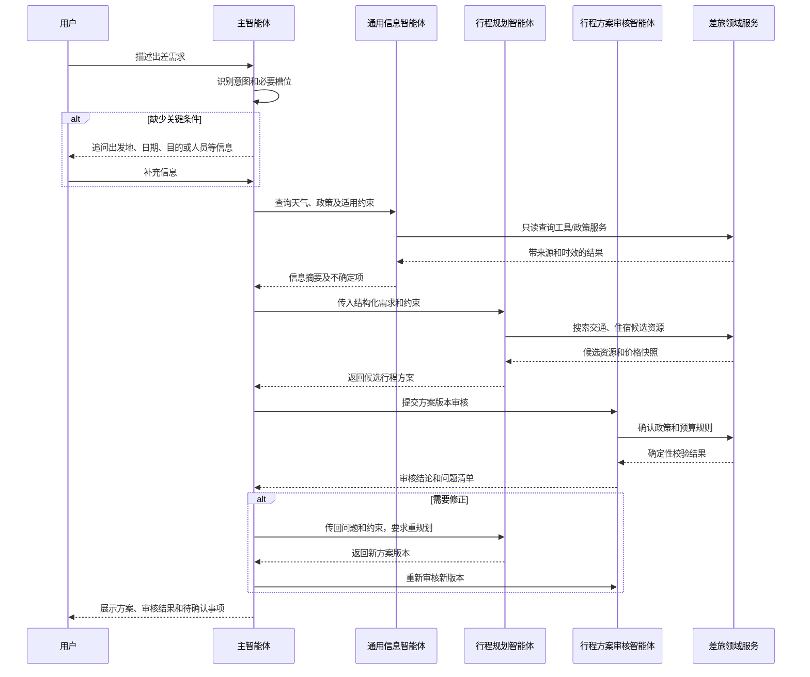

# 企业差旅多智能体划分方案

## 1. 文档目标

本文说明 CorpTripAgent 的多智能体目标划分、协作流程、权限边界和分阶段落地建议，作为后续 Agent、工具和差旅领域服务设计的依据。当前项目使用 AgentScope 1.0.12，AgentScope API 和实现均以该版本实际能力为准。

本文描述的是目标架构。当前代码已有主智能体和通用信息智能体的部分实现，其余智能体仍属于规划，具体现状见第 8 节。

## 2. 设计原则

1. **主智能体统一编排。** 用户只与主智能体交互；主智能体判断意图、收集缺失信息、调度领域智能体并整合结果，不让子智能体互相自由协商。
2. **Agent 负责理解和建议，领域服务负责事实和执行。** 权限、政策判定、预算计算、状态流转、价格校验和数据写入由确定性服务完成。智能体不得直连 Mapper、拼接 SQL 或自行宣称业务动作成功。
3. **通过结构化结果交接。** 子智能体返回明确的状态、数据、来源、有效期、限制和待确认事项；避免只用自由文本作为后续业务输入。
4. **读写能力按风险分级。** 查询和规划默认只读；创建、修改、取消订单或行程等动作必须经过授权工具，并按业务规则要求用户确认、幂等控制和审计。
5. **审核不是系统事实源。** 行程审核智能体可发现问题、说明理由和建议修正，但最终政策、预算、权限和订单规则必须由业务服务校验。
6. **失败时停止在安全状态。** 外部数据缺失、工具超时、方案过期或执行结果不确定时，明确告知用户并暂停相关动作，不伪造查询或预订结果。

## 3. 目标角色划分

| 智能体 | 主要职责 | 典型输入 | 典型输出 | 能力边界 |
| --- | --- | --- | --- | --- |
| 主智能体（编排） | 理解用户目标、识别任务阶段、追问必要信息、选择并串联子智能体、汇总结果并向用户确认 | 用户消息、当前会话、已授权的用户和业务上下文 | 追问、任务进度、结构化交接请求、面向用户的结果 | 不直接查询数据库或供应商，不自行审批、下单或修改业务状态 |
| 通用信息智能体 | 查询天气、差旅政策、差旅指南及目的地相关信息；解释查询依据、适用范围和时效 | 城市、日期、员工或组织适用范围、用户问题 | 天气和政策查询结果、来源与更新时间、限制及不确定性 | 只读；不规划完整交通住宿组合，不写业务数据，不把政策知识片段当作最终规则判定 |
| 行程规划智能体 | 根据出差目标和约束生成交通、住宿及日程候选方案，说明取舍 | 起讫地、日期、出差目的、偏好、预算和可用候选资源 | 一个或多个结构化候选方案、估算价格、时间安排、假设和缺口 | 只生成候选；不得预订、占用预算或把估价当成实时可订价格 |
| 预订下单智能体 | 在用户确认后协调交通/住宿预订工具，跟踪下单结果并处理可恢复异常 | 已审核且已确认的方案、确认凭证、业务主体和幂等键 | 订单结果、供应商单号、价格快照、退改规则或明确失败状态 | 只通过受控业务工具执行；必须复核确认版本、权限、价格和库存；不得自行绕过确认或重复扣款 |
| 行程方案审核智能体 | 对候选方案做独立检查，指出政策、预算、时间衔接、信息完整性和风险问题 | 方案快照、适用政策查询结果、预算和用户约束 | `PASS`、`REVISE` 或 `BLOCK` 结论、问题清单、依据和建议 | 审核只形成建议；关键规则由确定性服务复核。方案或政策版本变化后需重新审核 |
| 行程单管理智能体 | 查询和维护已确认的行程单，汇总订单、时间、地点和提醒；受控处理用户提出的变更、取消和归档请求 | 已有行程单标识、当前用户权限、变更意图和目标内容 | 行程单摘要、变更草案、提醒/异常信息、受控操作结果 | 只能通过行程领域服务读取或修改；影响订单的变更需转预订流程并重新确认，不得只改行程展示数据掩盖订单状态 |

## 4. 职责与工具边界

智能体角色是面向任务的理解和决策辅助单元，不等同于 Java 模块、权限主体或事务边界。每个智能体的工具都应按最小权限注册。

| 能力类别 | 使用角色 | 工具/服务责任 |
| --- | --- | --- |
| 当前用户身份、所属组织和角色 | 主智能体按需获取；领域工具再次校验 | 从已认证登录上下文获得身份，不采信自然语言自述 |
| 天气、目的地信息 | 通用信息智能体 | 调用天气 MCP 或其他只读信息服务，标注时间和数据来源 |
| 差旅政策、指南 | 通用信息智能体 | 检索知识库用于解释；适用规则与超标判断由政策服务返回结构化结果 |
| 资源搜索、价格与库存 | 行程规划智能体 | 通过供应商搜索适配器只读查询；记录查询时间和有效期 |
| 方案审核 | 行程方案审核智能体 | 结合政策、预算服务结果生成问题清单；保存被审核方案版本 |
| 创建、取消或变更订单 | 预订下单智能体 | 调用订单领域服务和供应商适配器；服务端落实权限、确认、幂等和审计 |
| 行程单查询、提醒和管理 | 行程单管理智能体 | 调用行程领域服务；状态变更由服务校验并持久化 |

模型输出应校验固定结构（字段白名单、类型、长度和枚举值）。子智能体不可将用户文本、知识库内容或供应商备注视为更高优先级指令。工具调用记录应关联用户、会话、任务、业务单号、工具名、结果、耗时和追踪标识，并按敏感信息策略脱敏。

## 5. 协作流程

### 5.1 新建并规划出差



关键槽位未齐时先追问，不使用模型猜测出发日期、人员、出发地等会影响审批或预订的事实。天气等信息应标注查询时间；政策结果应指出适用范围，查询不到时标记未知并按业务规则暂停。

### 5.2 用户确认后预订

1. 主智能体向用户展示审核通过的方案、价格、退改规则、有效期及需要确认的订单项目。
2. 用户确认后，服务端签发或验证与方案版本、价格快照和用户绑定的确认凭证；确认前后版本不一致时重新展示并确认。
3. 主智能体将确认后的结构化请求交给预订下单智能体。该智能体调用预订领域服务，工具服务端再次检查权限、方案状态、确认凭证和幂等键。
4. 预订结果以供应商查询与本地订单服务结果为准。超时状态先对账查询，不盲目重试；成功但本地保存失败时进入补偿/对账流程。
5. 预订成功后，行程单管理智能体读取已持久化订单和行程数据，生成行程单摘要并安排提醒。

### 5.3 已有行程查询和变更

行程单管理智能体可处理“查看我的行程”“整理行程单”“设置提醒”等请求。涉及改签、退票、取消住宿或改变订单日期时，应先生成变更草案并复核政策及费用，再由主智能体向用户展示确认；确认后转交预订下单智能体执行订单操作。行程单显示状态必须反映领域服务确认的订单状态。

## 6. 主智能体路由规则

| 用户目标 | 调度路径 |
| --- | --- |
| 查询天气、目的地信息或差旅政策 | 主智能体 -> 通用信息智能体 -> 汇总并标注来源和适用范围 |
| 规划尚未预订的出差方案 | 主智能体 -> 通用信息智能体（需要政策/天气时）-> 行程规划智能体 -> 行程方案审核智能体 -> 用户确认 |
| 用户要求直接预订，但尚无审核方案或确认 | 主智能体先补齐信息、规划、审核和展示；不得直接下单 |
| 对已确认方案执行预订 | 主智能体 -> 预订下单智能体 -> 订单领域服务 -> 行程单管理智能体同步展示 |
| 查询已有行程单、订单关联或提醒 | 主智能体 -> 行程单管理智能体 |
| 修改或取消已有订单 | 主智能体 -> 行程单管理智能体生成变更上下文 -> 重新审核（适用时）-> 用户确认 -> 预订下单智能体 |
| 多意图组合 | 主智能体按依赖顺序拆分任务，先只读查询和规划，再审核，最后执行有副作用的动作 |

一次任务的阶段和子智能体调用应能从会话上下文中追踪。子智能体失败时，主智能体说明失败发生在哪一步，并保留可恢复的任务信息；不得把部分完成描述为全流程成功。

## 7. 结构化交接数据建议

以下是领域交接契约示例，字段可按后续 Form/VO 设计调整；它不限定 AgentScope 1.0.12 的具体 API 写法。

```json
{
  "taskId": "task-123",
  "conversationId": "conversation-456",
  "requesterId": "user-789",
  "intent": "PLAN_ITINERARY",
  "businessNo": null,
  "inputVersion": 3,
  "constraints": {
    "origin": "上海",
    "destination": "深圳",
    "departAt": "2026-11-02T09:00:00+08:00",
    "returnAt": "2026-11-04T20:00:00+08:00",
    "budgetLimit": 4000
  },
  "policyCheck": {
    "status": "PASSED",
    "policyVersion": "policy-12"
  },
  "result": {
    "status": "NEED_REVIEW",
    "planId": "plan-234",
    "planVersion": 1
  },
  "requiresUserConfirmation": false,
  "traceId": "trace-345"
}
```

推荐的审核结论为 `PASS`、`REVISE`、`BLOCK`；预订结果至少区分 `SUCCEEDED`、`FAILED`、`PENDING_RECONCILIATION`，避免把未知状态折叠为成功或普通失败。时间使用明确时区；金额使用十进制定点类型，不能用浮点数参与金额计算。

## 8. 与当前代码的关系

截至本方案编写时，仓库已有如下实现基础：

- `MasterAgent` 以 prototype 方式创建主智能体，接入 AgentScope 上下文、Hook、SSE 和 `ask_user` 工具。
- `GeneralInfoAgent` 已接入天气 MCP、差旅指南/政策知识库、用户信息工具，并配置只读查询职责。
- `MasterAgent` 中构造了通用信息子智能体及 `SubAgentConfig`，但 `registerAgentTool(...)` 当前被注释；主智能体仍直接注册天气 MCP。因此当前不能视为完整的主从多智能体路由。
- 行程规划、预订下单、行程方案审核和行程单管理智能体尚未在当前 Agent 配置中实现。
- `ChatAgentPipeline` 承担对话调用、SSE 推送和消息持久化，不应继续堆入各差旅角色的业务规则；后续编排应保持与会话接入职责分离。
- Prompt 管理模块可用于管理各角色的 Prompt 版本，但 Prompt 不能替代工具权限、领域校验或服务端确认机制。

后续实现需遵守项目的分层约定，并针对 AgentScope 1.0.12 验证子智能体工具、运行时上下文、事件转发和恢复流程的实际 API 行为。当前代码或旧文档里其他版本信息不改变项目规定的 AgentScope 版本约束。

## 9. 分阶段落地建议

### 阶段一：统一编排和只读信息

- 主智能体能够可靠调用通用信息智能体，不在主智能体重复暴露其专属天气/政策工具。
- 统一子智能体输入输出结构，验证上下文、用户身份、会话和事件流转。
- 对天气和政策结果展示来源、时效、适用范围及未知状态。

### 阶段二：规划与独立审核

- 增加行程候选方案结构和版本快照。
- 接入只读交通、住宿搜索能力。
- 增加审核智能体，并将政策、预算、时序等关键规则接入确定性服务复核。
- 验证缺失信息、超标、无资源、方案版本变化等场景。

### 阶段三：受控预订

- 实现订单领域服务、供应商适配、确认凭证和幂等处理。
- 仅在审核通过且用户确认有效时开放创建订单工具。
- 覆盖供应商超时、重复请求、价格变化、部分成功和对账恢复。

### 阶段四：行程单管理

- 实现行程单查询、订单汇总、提醒及变更草案。
- 变更或取消订单通过预订下单流程执行，并保持行程单与订单状态一致。
- 增加权限边界、操作审计和行程完成归档流程。

每个阶段应形成可独立验证的业务闭环。初期保持单一主智能体统一调度，子智能体只在任务边界明确、确有独立工具或知识上下文时拆分；不以智能体数量作为功能完成度指标。

## 10. 关键验收场景

1. 只问目的地天气时，只读调用通用信息能力，并说明天气信息的时间范围。
2. 询问差旅标准时，返回适用范围和来源；政策资料不足时说明无法确认，不自行推导放行。
3. 规划行程时，缺少关键日期或目的地则先追问；完整时生成候选方案并保存方案版本。
4. 审核发现超标、衔接过紧或资源信息过期时，返回具体问题，不进入下单。
5. 用户要求下单但未确认价格和方案版本时，系统不创建订单。
6. 用户确认后遇到重复请求，幂等机制不产生重复订单；供应商超时先查询订单状态。
7. 查询或变更行程单时校验当前用户对业务对象的权限；改签、取消等动作保留确认和审计记录。
8. 任一子智能体或外部工具失败时，主智能体准确说明已完成与未完成的步骤，不伪造成功状态。
