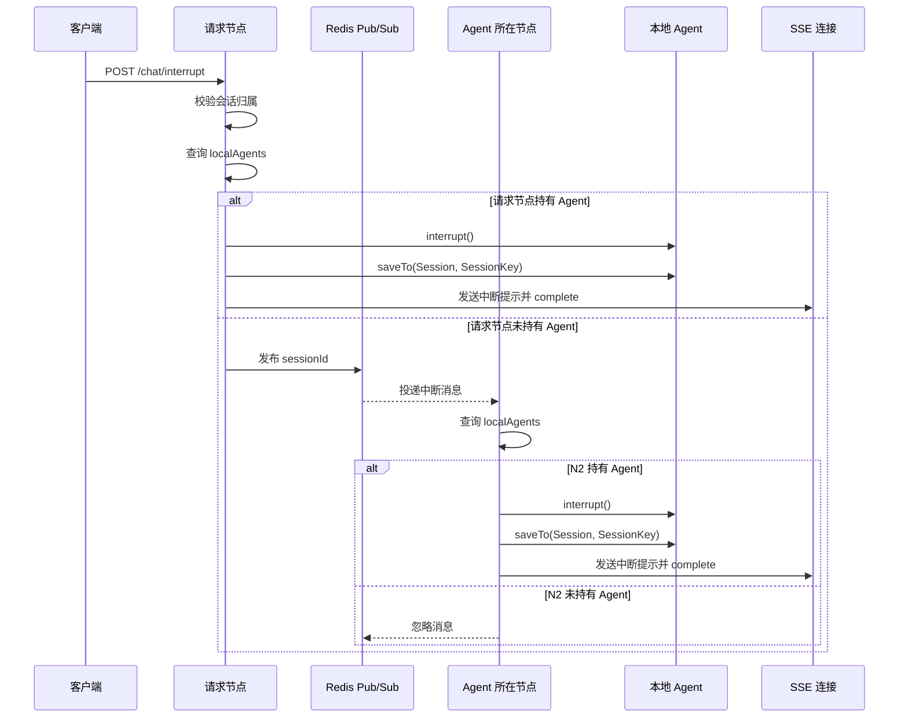

# 分布式 Agent 中断恢复功能实现

## 1. 功能背景

聊天请求通过 SSE 长连接执行，Agent 实例只存在于实际执行请求的应用节点内。用户发送中断请求时，请求节点不一定持有目标会话的 Agent：

- 请求节点持有 Agent 时，直接调用本地 Agent 的中断方法。
- 请求节点没有目标 Agent 时，通过 Redis Pub/Sub 将会话 ID 广播到集群。
- 其他节点收到广播后查询本地活跃 Agent，命中目标会话的节点负责后续中断。
- 中断完成后，命中节点保存 AgentScope 会话状态，并关闭该节点上的 SSE 连接。

当前实现保存的是中断时的会话快照，为后续恢复提供状态基础；系统目前没有在中断后自动重新启动 Agent 的续跑接口。

## 2. 实现目标

1. 按会话维护当前节点正在执行的主 Agent 和子 Agent。
2. 中断请求优先走本地快速路径，减少 Redis 依赖和网络延迟。
3. 本地未命中时广播到所有应用节点，使真正持有 Agent 的节点完成中断。
4. 监听节点只执行本地处理，不重复广播，避免消息回环。
5. 中断后持久化每个 Agent 的会话状态，减少中断造成的上下文丢失。
6. 由持有 SSE 连接的节点发送中断提示并结束连接。

## 3. 主要代码结构

| 文件 | 职责 |
| --- | --- |
| `src/main/java/cn/lwccxy/trip/agent/AgentRegistry.java` | 维护本机活跃 Agent；执行本地中断；本地未命中时发布 Redis 消息 |
| `src/main/java/cn/lwccxy/trip/agent/hooks/AgentRegistryHook.java` | 在 AgentScope `PreCall`、`PostCall` 和 `Error` 生命周期事件中登记或移除 Agent |
| `src/main/java/cn/lwccxy/trip/agent/listener/AgentInterruptMessageListener.java` | 接收 Redis 中断消息，并在命中节点执行本地中断和 SSE 收尾 |
| `src/main/java/cn/lwccxy/trip/agent/config/AgentInterruptRedisConfig.java` | 创建 Redis 消息监听容器并订阅中断频道 |
| `src/main/java/cn/lwccxy/trip/business/chat/ChatAgentPipeline.java` | 校验会话归属，发起中断，并封装中断后的 SSE 通知 |
| `src/main/java/cn/lwccxy/trip/agent/session/CorpTripSessionKey.java` | 使用会话 ID 和 Agent 名称构造会话持久化键 |

## 4. 本地活跃状态登记

`AgentRegistry` 使用以下结构维护本机状态：

```text
Map<sessionId, Set<Agent>> localAgents
```

同一个会话可以同时包含主 Agent 和多个子 Agent，因此使用集合而不是单个实例。集合由 `ConcurrentHashMap` 创建，注册和移除使用 `compute`、`computeIfPresent` 完成会话级原子更新。

`AgentRegistryHook` 从 Reactor Context 读取 `agentRuntimeContext`：

1. `PreCallEvent`：将当前 Agent 加入对应会话的活跃集合。
2. `PostCallEvent`：正常结束后移除 Agent。
3. `ErrorEvent`：异常结束后移除 Agent。
4. 会话集合为空时，同时移除会话键，避免中断请求命中已经结束的 Agent。

重复触发 `PreCallEvent` 不会重复加入同一实例；同一会话下的不同 Agent 仍会分别登记。

## 5. 中断请求流程

`ChatAgentPipeline.interrupt` 首先校验当前用户是否拥有目标会话，然后调用：

```java
agentRegistry.interrupt(conversationId.toString());
```

整体流程如下：



### 5.1 本地命中

`AgentRegistry.interrupt` 先调用 `interruptLocally`。本地命中时：

1. 对活跃 Agent 集合创建快照，避免遍历期间受到并发注册或移除影响。
2. 对快照中的每个 Agent 调用 `interrupt()`。
3. 将每个 `ReActAgent` 保存到 AgentScope `Session`。
4. 返回 `true`，由当前 `ChatAgentPipeline` 调用 `notifyInterrupted`。

### 5.2 集群广播

本地没有活跃 Agent 时，向固定频道发布会话 ID：

```text
corp-trip-agent:agent:interrupt
```

消息体只包含 UTF-8 编码的 `sessionId`，不传递 Agent 实例、用户信息或节点内部对象。发布是异步 Pub/Sub 语义，`interrupt` 返回 `false`，表示请求节点没有本地命中；真正命中的节点负责后续处理。

Redis 发布异常会被记录并保留原有未命中语义，不会因为广播失败阻塞请求线程。

## 6. Redis 监听处理

`AgentInterruptRedisConfig` 创建 `RedisMessageListenerContainer`，为每个应用节点订阅同一个中断频道。`AgentInterruptMessageListener` 收到消息后：

1. 将消息体按 UTF-8 解码为会话 ID。
2. 空会话 ID 直接忽略。
3. 调用 `agentRegistry.interruptLocally(sessionId)`，只查询本节点状态。
4. 本节点未命中时记录调试日志并返回，不再次发布消息。
5. 本节点命中并完成 Agent 中断、会话保存后，调用 `chatAgentPipeline.notifyInterrupted(sessionId)`。

监听端使用 `interruptLocally` 而不是 `interrupt`，是为了防止 Redis 消息在节点之间形成循环广播。

## 7. 会话状态保存与恢复边界

中断处理对每个 `ReActAgent` 使用以下会话键保存状态：

```text
new CorpTripSessionKey(sessionId, agentName)
```

其标识形式为：

```text
sessionId_agentName
```

这样可以隔离同一业务会话中的多个 Agent，避免主 Agent 和子 Agent 共享错误的上下文。

需要区分两个概念：

- **中断保存**：当前功能已经实现。Agent 收到中断请求后，将当前状态写入 AgentScope `Session`。
- **执行恢复**：当前代码只准备了持久化状态，没有自动创建新 Agent、加载会话并继续执行的业务入口。后续实现恢复接口时，应使用相同的 `CorpTripSessionKey` 读取对应 Agent 状态，并重新建立新的运行上下文和 SSE 连接。

## 8. SSE 收尾行为

`ChatAgentPipeline.notifyInterrupted` 统一完成以下操作：

1. 按会话 ID 从 `SseEmitterRegistry` 获取连接。
2. 发送 `delta` 事件，内容为：

   ```text
   已经成功中断Agent执行, 还有什么可以帮助到您的吗？
   ```

3. 连接存在时调用 `complete()` 结束 SSE。

本地命中由请求线程调用该方法；跨节点命中由实际持有 SSE 连接的监听节点调用，因此请求节点不需要持有远端节点的连接对象。

## 9. 配置和运行要求

项目已通过现有 Sa-Token Redis 依赖引入 Spring Data Redis，使用 `StringRedisTemplate` 和 `RedisMessageListenerContainer`。运行前需要确认：

- Redis 地址、端口、密码和数据库编号配置正确。
- 所有应用节点连接同一个 Redis 实例或同一个 Redis 集群。
- 各节点使用相同的 `INTERRUPT_CHANNEL` 值。
- 应用使用干净构建产物启动，避免旧 `target/classes` 中残留已删除或移动的监听器类。

当前配置位于：

```text
src/main/resources/config/application.yml
```

## 10. 异常与并发处理

- 会话 ID 为空时不执行本地查询或 Redis 发布。
- 本地 Agent 集合为空时只执行一次广播。
- 使用集合快照执行中断，降低并发修改导致的遍历异常风险。
- 正常结束和异常结束都会通过 Hook 清理活跃状态。
- Redis 发布失败只记录日志，不将 Redis 异常扩散到聊天中断接口。
- SSE 连接缺失、已结束或发送失败时由 `SseEmitterSender` 记录并跳过，不影响 Agent 中断本身。
- Spring 注入 `StringRedisTemplate` 使用按类型注入，避免 `@Resource` 按字段名匹配到类型为 `RedisTemplate` 的 Bean。

## 11. 测试与验证

已覆盖的单元测试场景：

1. 本地没有活跃 Agent 时发布 Redis 中断消息。
2. 本地命中 Agent 时执行中断和会话保存，且不发布 Redis 消息。
3. Redis 监听节点命中会话时调用 SSE 中断收尾。
4. Redis 监听节点未命中会话时不发送 SSE 通知。

主代码可以使用以下命令编译：

```powershell
mvn -DskipTests compile
```

构建运行包时建议使用干净构建：

```powershell
mvn clean package -Dmaven.test.skip=true
```

项目中已有部分测试仍引用与当前 AgentScope 1.0.12 不匹配的旧类名，执行完整 `mvn test` 时可能在测试编译阶段失败；该问题与分布式中断实现无关。

## 12. 后续可扩展方向

1. 增加中断请求唯一 ID、发送时间和来源节点，便于幂等处理和链路追踪。
2. 对同一会话增加分布式幂等控制，避免多个客户端同时发起中断时重复保存状态。
3. 增加恢复接口：读取指定 `CorpTripSessionKey` 的会话状态，创建 Agent 并继续执行。
4. 对 Redis 不可用、监听延迟和无节点命中的情况增加监控指标与告警。
5. 多实例部署时评估 Redis Cluster、哨兵或统一消息基础设施的可用性要求。
