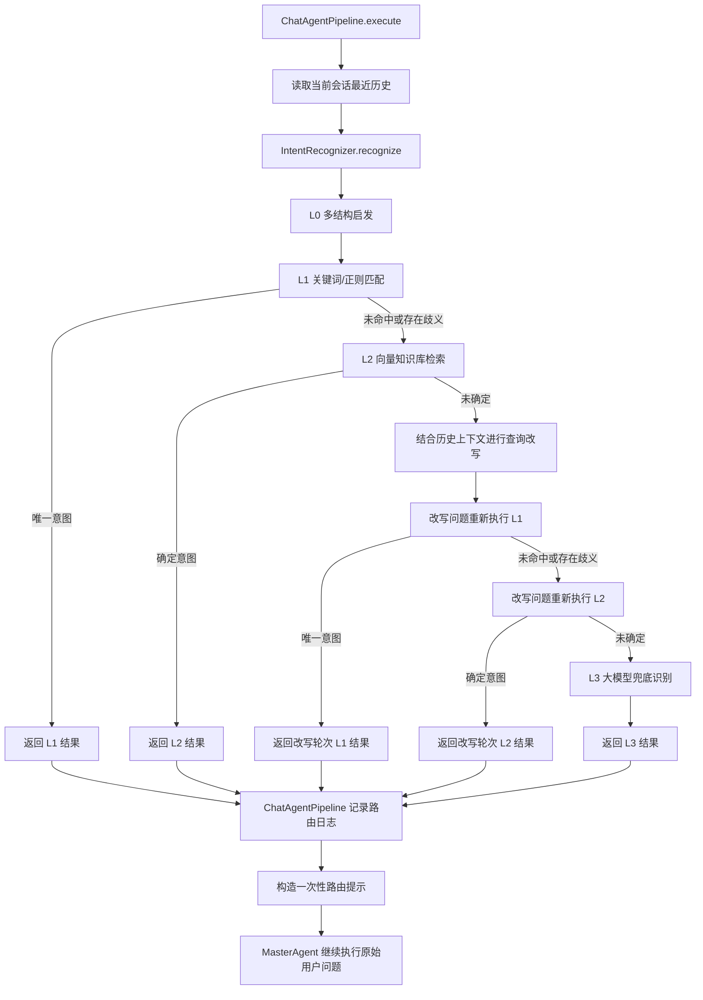

# 意图识别架构与指标记录

## 1. 架构概览

当前意图识别由 `IntentRecognizer` 负责分层识别，由 `ChatAgentPipeline` 负责在一次会话请求中调用识别器，并把识别结果交给 `MasterAgent` 作为路由参考。



L0 只提供“是否可能包含多个独立请求”的结构线索，不直接返回业务意图。即使 L0 判断为多结构候选，当前实现仍会先让 L1 和 L2 尝试识别；只有 L1/L2 无法形成确定结果时，才进入查询改写和 L3。

## 2. 各层职责和返回

### L0：多结构启发

`recognizeL0` 根据问题长度、句中连接词和分句结构判断是否存在多意图候选。常见连接词包括“并且”“顺便”“然后”“再”等。该层特点是本地字符串判断，通常耗时为毫秒级，不调用模型和向量库。

返回类型为 `RecognitionResultL0`：

| 字段 | 含义 |
| --- | --- |
| `multiIntent` | 是否存在多结构候选 |
| `cause` | 启发式判断原因 |

### L1：关键词和正则匹配

`recognizeL1` 先按标点和中间连接词拆分子句，再对每个子句匹配 `IntentType` 中配置的关键词。只有所有子句最终只对应一个业务意图，且没有单个子句命中多个意图时，才认为 L1 已经确定结果。

L1 直接命中时返回 `RecognitionResultL1`，其 `level()` 为 `L1`。如果没有命中、命中多个意图或出现子句歧义，则继续进入 L2。

### L2：向量知识库检索

`recognizeL2` 从 `intentKnowledge` 检索最多两个候选表达，并读取文档 metadata 中的 `intent` 字段。判断规则如下：

- 没有有效候选时，标记为未确定。
- 两个候选属于同一意图时，直接确定该意图。
- 两个候选属于不同意图且分差不超过 `0.5` 时，标记为意图摇摆。
- 分差超过 `0.5` 时选择分数更高的意图。

L2 确定时返回 `RecognitionResultL2`，其 `level()` 为 `L2`；未确定时返回 `UNKNOWN` 并触发后续查询改写。

### 查询改写：结合会话历史重试

在原问题的 L1/L2 都未确定时，识别器只执行一次查询改写。`ChatAgentPipeline` 会在保存本轮用户消息前，从 `t_message` 查询当前会话最近最多 12 条消息，按时间正序转换成 `ConversationTurn`，避免把当前问题重复放入历史。

改写模型输入包含：

1. 当前会话历史消息；
2. 当前用户问题；
3. 改写约束，要求补全历史中明确出现的指代、地点、日期和业务对象，不得补造事实。

识别器最多保留 6000 个历史字符，优先保留靠近当前问题的最近内容。改写完成后重新执行 L1，再执行 L2；改写后的问题不会替换用户原始消息，也不会写回会话消息表。

### L3：大模型最终兜底

查询改写后的 L1/L2 仍未确定时，调用强模型执行最终意图识别。L3 使用资源文件 `src/main/resources/sysprompt/IntentRecognitionPrompt.md`，该提示词包含角色定义、意图路由表、判定规则、输出 JSON 协议和 Few-shot 示例。

提示词规定的输出格式为：

```json
{
  "isMultiIntent": false,
  "intents": [
    {
      "targetIntent": "TRAVEL_POLICY_QUERY",
      "targetAgent": "GeneralInfoAgent",
      "confidence": 0.96,
      "clause": "查询酒店住宿标准"
    }
  ]
}
```

代码兼容解析 `isMultiIntent`、`intents[].targetIntent`，同时兼容旧的 `multiIntent` 和 `intentType` 字段。当前统一结果契约是 `IntentRecognitionResult`，具体返回类型为 `RecognitionResultL1`、`RecognitionResultL2` 或 `RecognitionResultL3`。多意图结果使用 `multiIntent=true`，并取第一个合法意图兼容现有主 Agent 路由字段。

## 3. ChatAgentPipeline 中的编排

`ChatAgentPipeline#execute` 的关键顺序如下：

1. 校验问题并创建或读取会话。
2. 读取本轮问题之前的会话历史。
3. 保存本轮用户消息。
4. 创建 `AgentRuntimeContext`。
5. 调用 `IntentRecognizer#recognize(question, history)`。
6. 记录识别层级、意图、目标 Agent、多意图标识和耗时。
7. 构造一次性 system 路由提示，并与原始用户消息一起发送给 `MasterAgent`。
8. `MasterAgent` 仍以原始用户问题为最终依据，继续执行工具或子 Agent 调度。

路由提示只拼接枚举值和识别结果，不拼接用户原文，因此识别结果是路由参考，不会把用户输入直接提升为 system 指令。意图识别异常时，Pipeline 使用 `UNKNOWN` 的 L3 结果继续执行主 Agent，避免识别故障阻断对话。

## 4. 关键指标日志

### 识别层指标

| 日志 | 字段 | 说明 |
| --- | --- | --- |
| `[意图识别L0层]` | `多结构候选` | L0 是否发现多结构候选 |
|  | `原因` | L0 启发式判断原因 |
|  | `耗时` | L0 本地判断耗时，单位 ms |
| `[意图识别L1层]` | `轮次` | `原问题` 或 `改写问题` |
|  | `子句数` | 本轮拆分出的子句数量 |
|  | `候选意图` | 关键词命中的意图集合 |
|  | `多意图` | 是否存在多个意图或歧义 |
|  | `耗时` | L1 匹配耗时，单位 ms |
| `[意图识别L2层]` | `轮次` | `原问题` 或 `改写问题` |
|  | `意图` | L2 选择的意图，未确定时为 `UNKNOWN` |
|  | `需继续` | 是否进入改写或 L3 |
|  | `耗时` | 向量检索和候选判断耗时，单位 ms |

### 模型调用审计指标

模型调用统一输出 `[模型调用审计]`：

| 字段 | 说明 |
| --- | --- |
| `场景` | `意图查询改写` 或 `意图识别L3` |
| `结果` | 模型调用结果 |
| `模型` | 实际模型名称 |
| `输入Token` | 输入 Token 数量 |
| `输出Token` | 输出 Token 数量 |
| `总Token` | 服务端返回的总 Token 数量 |
| `模型耗时` | 模型服务返回的耗时，单位秒 |
| `估算费用` | 按 `ModelTokenBillingUtil` 计算的人民币费用 |
| `总耗时` | 从本地发起调用到完成解析的墙钟耗时，单位 ms |

改写完成后还会输出 `[意图查询改写完成]`，包含原问题、改写后问题和本地总耗时。该日志便于判断改写是否真正补全了当前问题的上下文。

### Agent 首 Token 指标

`ChatAgentPipeline#execute` 在提交 `masterAgent.stream` 时开始计时。首次收到非空推理文本时打印：

```text
[Agent首Token指标] conversationId={}, 首Token时长={}ms
```

如果模型不发送中间推理事件，则在最终 Agent 结果出现非空文本时记录。使用并发标记保证一轮对话只打印一次。

## 5. 生产日志样例分析

以下是一次用户问题“我还想再查询一下北京的”的识别日志。该轮上下文中，模型将省略的业务对象补全为北京今天的天气。

### 分层耗时

| 阶段 | 结果 | 耗时 |
| --- | --- | ---: |
| L0 | 多结构候选为 `true` | `0ms` |
| 原问题 L1 | 2 个子句，候选意图为空 | `1ms` |
| 原问题 L2 | `UNKNOWN`，需要继续 | `147ms` |
| 查询改写模型 | 改写成功 | `3.775s` 模型耗时，`3781ms` 本地总耗时 |
| 改写完成日志 | 原问题改写为“查询北京今天的天气。” | `3783ms` |
| 改写问题 L1 | 命中 `TRAVEL_INFO_QUERY` | `0ms` |

从日志看，原问题的本地规则和向量检索共耗时约 `148ms`；查询改写是本轮主要耗时来源，约 `3.78s`。改写后直接由 L1 命中，因此本轮没有继续调用改写后的 L2，也没有调用 L3 意图模型。

### 查询改写模型用量和费用

| 指标 | 数值 |
| --- | ---: |
| 模型 | `qwen3.8-flash` |
| 输入 Token | `1270` |
| 输出 Token | `191` |
| 总 Token | `1461` |
| 模型耗时 | `3.775s` |
| 本地总耗时 | `3781ms` |
| 估算费用 | `0.00153170` 元 |

按照当前价格配置（输入 `0.8` 元/百万 Token，输出 `2.7` 元/百万 Token），费用计算为：

```text
输入费用 = 1270 / 1,000,000 × 0.8 = 0.001016 元
输出费用 = 191 / 1,000,000 × 2.7 = 0.0005157 元
合计约   = 0.0015317 元
```

这条样例没有出现 `[意图识别L3]` 模型审计日志，说明改写后 L1 已经命中，L3 没有被调用，L3 的 Token、费用和耗时不能从本次日志推断。

## 6. 指标解释和后续统计建议

当前日志已经可以区分规则层耗时、向量检索耗时、查询改写模型耗时、L3 模型耗时和 Agent 首 Token 时长。建议后续按 `conversationId` 或请求 trace 标识关联一整轮日志，并持续统计以下指标：

- L1 直接命中率、L2 直接命中率、改写后 L1/L2 命中率和 L3 触发率。
- 原问题 L2 未确定率，以及 L2 未确定的原因分布。
- 查询改写成功率、改写后意图变化率和改写后命中层级。
- 改写与 L3 的输入/输出 Token、单次费用、P50/P95/P99 耗时。
- Agent 首 Token P50/P95/P99 耗时。
- 历史消息数量、改写上下文字符数与模型耗时之间的关系。

当前日志中的问题原文和改写结果包含用户业务内容，生产环境应结合日志访问权限、脱敏策略和保留周期进行管理；Token、费用和耗时指标可以在不记录完整问题正文的审计日志中单独保留。
