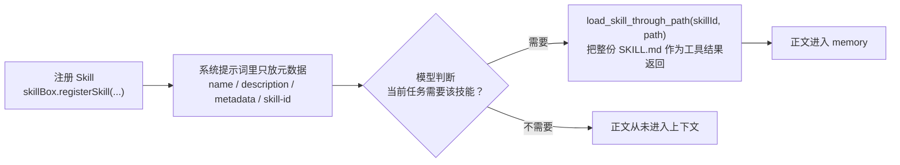
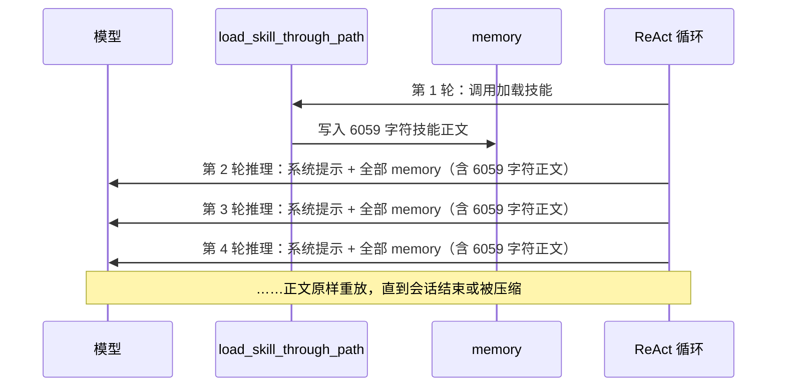
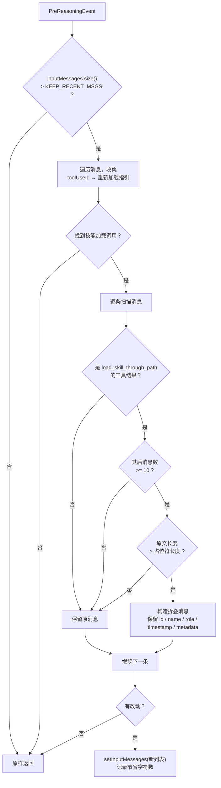

# 技能正文折叠 Hook 设计与实现

## 1. 一句话结论

`SkillContentCollapseHook` 在每次模型推理前，把「已经用完的历史技能正文」替换成一行占位符，只改这一轮发给模型的消息，不改 memory 原文。它解决的不是「Skill 加载浪费上下文」，而是**「Skill 正文一旦加载，就会在之后每一轮推理里被完整重放」**这个问题。

| 项目 | 内容 |
|---|---|
| 实现类 | `src/main/java/cn/lwccxy/trip/agent/hooks/SkillContentCollapseHook.java` |
| 监听事件 | `PreReasoningEvent` |
| Hook 优先级 | `6`（早于 `SkillHook` 的 55 和 `AgentExecutionMonitorHook` 的 50） |
| 挂载位置 | `ItineraryPlanningAgent` 的 `.hooks(...)` 列表 |
| 是否改 memory | 否 |
| 是否有状态 | 无（可跨会话共享） |
| 是否调用模型 | 否（纯字符串处理） |

---

## 2. 这个 Hook 的作用

一句话：**把「一次性用过的长文本」从每一轮的推理输入里摘出去，但保留「需要时可以再取回来」的线索。**

具体做三件事：

1. **识别**：在本次推理的输入消息中，找出 `load_skill_through_path` 工具产生的工具结果（技能正文）。
2. **判定**：只有在该结果之后已经积累了足够多的后续消息（默认 10 条）时，才认为「技能已经完成使命」，可以折叠。
3. **替换**：把整份技能正文换成一个占位符，占位符里带上**精确的重新加载指令**（`skillId` 和 `path` 都填好），模型若还需要细节可以直接复用。

它不做的事：

- 不删除 memory 里的原文，下一轮仍会拿到完整消息，再按需折叠。
- 不改工具执行逻辑、不改工具返回结果、不拦截用户请求。
- 不调用大模型做摘要，因此没有额外延迟和额外费用。

---

## 3. 为什么 Skill 本来就省上下文，还要折叠？

这是本文最需要说清楚的一点。Skill 的「省」和本文的「再省」是**两个不同层面**。

### 3.1 Skill 的第一层节省：按需加载

AgentScope 的 `SkillBox` 采用的是「元数据常驻 + 正文按需」的两级结构：



以本项目的 `tuniu-cli` 为例，实测数据：

| 内容 | 字符数 | 何时进入上下文 |
|---|---:|---|
| `SKILL.md` frontmatter（name / description / metadata） | 472 | 每轮常驻（约 511 字符含 XML 标签） |
| `SKILL.md` 正文 | 5578 | 仅在 `load_skill_through_path` 调用后 |
| `SKILL.md` 全文 | 6059 | — |
| `references/flight.md` | 2344 | 单独调用 `load_skill_through_path` 时才加载 |
| `references/hotel.md` | 1519 | 同上 |
| `references/intelflight.md` | 3305 | 同上 |
| `references/train.md` | 1735 | 同上 |

也就是说，不加载时每轮只花约 511 字符，比整份 6059 字符省了约 **92%**。这确实是 Skill 设计的核心价值。

### 3.2 第一层节省的盲区：加载之后，正文再也不走了

`load_skill_through_path` 的结果会作为 `ToolResultBlock` 写进 memory。而 `ReActAgent.prepareMessages()` 的实现是：

```text
本轮推理输入 = 系统提示词 + memory.getMessages()（全部历史消息）
```

也就是 **ReAct 每一轮推理都会把整个 memory 重放给模型**。于是同一个技能正文会经历：



第 2 轮用它，第 3 轮可能只在收尾用一次，第 10 轮以后它已经变成纯粹的「历史包袱」，但**它依然按全量计费**。

这就是盲区：**Skill 省的是「加载前的轮次」，没有处理「加载后的轮次」。** 正文加载一次，代价却是按「后续推理轮数」重复支付。

### 3.3 为什么不能只靠 AutoContextMemory 自动压缩

本项目用的是 `AutoContextMemory`，它确实有压缩能力，但它不是为这种场景设计的：

| 机制 | 默认值 | 对技能正文的实际效果 |
|---|---:|---|
| `largePayloadThreshold`（大消息卸载） | 5120 | 超过阈值的大消息可能被卸载，但受 `lastKeep` 窗口限制（判定单位以框架实现为准） |
| `lastKeep`（尾部保留条数） | 50 条 | 技能正文只要还在最近 50 条里，就不会被压缩 |
| `msgThreshold`（触发压缩的消息数） | 100 条 | 会话消息不足 100 条时根本不触发 |
| `minCompressionTokenThreshold` | 5000 | 压缩收益不够时不压缩 |

问题在于：**技能正文最需要被折叠的那段时间（刚加载完、正在连续执行搜索），恰恰落在 `lastKeep` 窗口内，自动压缩不会动它。** 等它移出窗口，可能已经重放了十几轮。

而且自动压缩是**调用模型做摘要**的：有延迟、有额外 Token、有摘要失真的风险。而技能正文的折叠不需要任何智能判断——「这条消息是不是 10 条以前加载的 SKILL.md」是一个确定性问题。

### 3.4 两种节省的对比

| 层面 | 节省方式 | 作用范围 | 本项目实现 |
|---|---|---|---|
| 第一层 | 元数据常驻、正文按需 | 加载**前**的每一轮 | AgentScope `SkillBox` / `SkillHook` |
| 第二层 | 历史正文折叠 | 加载**后**的每一轮 | `SkillContentCollapseHook` |

两层是叠加关系，不是替代关系。所以「Skill 本来就省上下文」和「还需要折叠」并不矛盾。

---

## 4. 折叠是怎么做的

### 4.1 挂载位置与优先级

Hook 挂在 `ItineraryPlanningAgent` 上，优先级为 `6`：

| 优先级 | Hook | 与折叠的关系 |
|---:|---|---|
| 6 | `SkillContentCollapseHook` | 先折叠 |
| 10 | `TuniuApiKeyShellHook` | — |
| 20 / 30 | `TuniuSearchResultHook` / `TuniuSearchResultCaptureHook` | — |
| 50 | `AgentExecutionMonitorHook` | 在折叠**之后**统计输入字符数，日志反映真实值 |
| 55 | `SkillHook`（框架内置） | 在折叠**之后**向系统消息注入技能元数据 |
| 100 | `ProgressNotificationHook` 等 | 默认优先级 |

优先级取 `6` 的原因很直接：`AgentExecutionMonitorHook` 会打印「推理开始, 输入字符数=N」。如果折叠排在它后面，日志里的 N 就是折叠前的假数据，无法用来验证优化效果。

> 框架按 `priority()` 升序执行（`AgentBase.sortHooks()` 使用 `Comparator.comparingInt(Hook::priority)`），数值越小越先执行。

### 4.2 处理流程



对应的核心代码逻辑（`handle` 方法）：

```java
List<Msg> messages = event.getInputMessages();
if (messages == null || messages.size() <= KEEP_RECENT_MSGS) {
    return Mono.just(event);
}
// 1. 先收集所有技能加载调用的重载指引
Map<String, String> reloadHints = collectReloadHints(messages);
if (reloadHints.isEmpty()) {
    return Mono.just(event);
}
// 2. 仅折叠「其后已有足够多消息」的技能结果
for (int i = 0; i < messages.size(); i++) {
    ToolResultBlock skillResult = extractSkillLoadResult(messages.get(i));
    int messagesAfter = messages.size() - 1 - i;
    if (skillResult != null && messagesAfter >= KEEP_RECENT_MSGS) {
        // 3. 占位符不比原文短时不折叠
        ...
    }
}
// 4. 只替换本轮输入快照
event.setInputMessages(newMessages);
```

### 4.3 五个关键实现细节

#### 细节一：只改输入快照，不改 memory

`PreReasoningEvent#setInputMessages` 修改的是**本次推理的入参副本**，memory 中的原始消息完全不受影响。

这样带来两个好处：

- **无状态**：Hook 不需要记录「哪些消息已经折叠过」，不持有任何会话级数据，天然可以跨 Agent、跨会话共享。
- **可逆**：即使某一轮判断失误，下一轮仍从完整 memory 重新计算，不会造成信息永久丢失。

代价是每轮都要重新扫描一遍消息（O(n) 的字符串长度计算），但这个开销远小于一次模型调用。

#### 细节二：保留消息身份

折叠不是「新建一条消息」，而是**复制原消息的全部身份字段，只替换内容块**：

| 字段 | 处理 |
|---|---|
| `id` | 保留原值（工具结果关联依赖它） |
| `name` | 保留原值，为空时回退到 Agent 名称 |
| `role` | 保留 `TOOL` |
| `timestamp` | 保留原值 |
| `metadata` | 浅拷贝一份（见细节三） |
| `generateReason` | 保留原值 |
| 其余 `ContentBlock` | 原样保留，只替换技能结果那一个块 |

参考实现用的是 `Msg.builder()` 全新构造，会丢掉 `id` 和 `timestamp`。本项目保留了它们，原因与 `TuniuSearchResultHook` 一致：**模型侧依靠工具调用 ID 关联 `ToolUseBlock` 和 `ToolResultBlock`，消息身份被改写可能导致协议层错位。**

#### 细节三：metadata 必须拷贝后再传入 Builder

这是一个容易踩的坑。`Msg.Builder.generateReason()` 的实现是：

```java
// AgentScope 1.0.12 Msg$Builder.generateReason 反编译结果（简化）
if (generateReason != null) {
    if (metadata == null || metadata.isEmpty()) {
        metadata = new HashMap<>();
    } else if (!(metadata instanceof HashMap)) {
        metadata = new HashMap<>(metadata);
    }
    metadata.put("agentscope_generate_reason", generateReason.name());
}
```

如果直接把 `original.getMetadata()` 传给 Builder，而它恰好是 `HashMap` 实例，`put` 会**原地修改 memory 中那条原始消息的 metadata**——「只改本轮输入」的约定就被破坏了。所以代码显式做了一次 `new HashMap<>(original.getMetadata())`。

#### 细节四：占位符携带可执行的重新加载指令

折叠不是简单写一句「已省略」。`collectReloadHints` 会先扫描所有 `load_skill_through_path` 调用，解析 `skillId` 和 `path`（兼容 `skillId` 与 `skill_id` 两种写法、Map 与 JSON 字符串两种入参形式），生成精确指引：

```text
load_skill_through_path(skillId="tuniu-cli", path="SKILL.md")
```

参数缺失或解析失败时降级为：

```text
load_skill_through_path(skillId="<skill-id>", path="SKILL.md")
```

这样模型需要细节时不需要猜测，直接照抄即可。

#### 细节五：只在「确实更短」时折叠

如果原文本身就比占位符短（例如某次加载只返回了一句错误提示），折叠反而会**增大**上下文。因此有 `originalLength > placeholder.length()` 的判断。

---

## 5. 折叠后的效果

### 5.1 单条消息：折叠前 vs 折叠后

**折叠前**（`ToolResultBlock` 的 output 为 6059 字符）：

```text
Successfully loaded skill: tuniu-cli

Name: tuniu-cli
Description: 企业差旅助手，通过 tuniu CLI 查询和预订酒店住宿、国内/国际航班及火车票……
Source: SKILL.md

Content:
---
# 途牛旅行助手

> **首次调用任一服务前，必须先 Read `references/<server>.md` 确认工具名与参数……**

仅处理企业差旅相关的酒店住宿、国内/国际航班和火车票……

## 意图分流决策表
### 酒店
……
（后续 150 余行正文，共 5578 字符）
---
```

**折叠后**（119 字符，`path="SKILL.md"` 时）：

```text
[技能文档正文已省略以节省上下文] 该技能的说明此前已加载，你应已据此完成相应操作。如仍需查阅完整说明，请重新调用：load_skill_through_path(skillId="tuniu-cli", path="SKILL.md")
```

### 5.2 单条消息的字符数变化

| 加载内容 | 折叠前（文件正文，实测） | 折叠后（占位符） |
|---|---:|---:|
| `SKILL.md` | 6059 | 119（实测） |
| `references/flight.md` | 2344 | 111 + `references/flight.md` 长度 |
| `references/hotel.md` | 1519 | 111 + `references/hotel.md` 长度 |
| `references/train.md` | 1735 | 111 + `references/train.md` 长度 |
| `references/intelflight.md` | 3305 | 111 + `references/intelflight.md` 长度 |

> 折叠前为按 UTF-8 读取文件后的实测字符数；工具结果还会在外面包一层 `Successfully loaded skill: ... / Content:` 头尾，因此实际工具结果略大于上表的文件正文。
> 占位符中固定文案为 111 字符，加上 `path` 的字符数即为折叠后长度；`references/*.md` 因路径更长，占位符也在 130 字符左右，量级不变。
> 换算成 Token 时因模型分词策略不同会有差异，这里不给出精确 Token 数。

### 5.3 一次典型规划会话的累计效果

行程规划会话通常会依次加载 `SKILL.md` + 若干 `references`。假设加载了 `SKILL.md`、`flight.md`、`hotel.md` 三份（合计 9922 字符），且都在会话前半段加载完成：

| 轮次 | 折叠前每轮输入中的技能正文 | 折叠后每轮输入中的技能正文 |
|---:|---:|---:|
| 加载当轮及之后 10 条消息内 | 9922 | 9922（不折叠） |
| 之后每一轮 | 9922 | 约 380（三个占位符合计） |

也就是说，**折叠生效后，每一轮推理稳定少发送约 9500+ 字符，降幅约 96%**。会话越长、技能加载越早，累计收益越大——而这正是行程规划 Agent 的常态（`maxIters(100)`，一次规划可能几十轮）。

### 5.4 对模型行为的影响

折叠本身是「减法」，但它依赖提示词里的一条配套约定（`ItineraryPlanningAgentPrompt.md` 规则 4.1）：

> **懒加载搜索技能（重要）**：搜索类 skill 必须**在本步骤开始时**才通过 `load_skill_through_path` 加载……原因：技能正文加载后若长时间不用会被上下文折叠，等到真正搜索时说明已丢失，导致搜错命令或工具名。
>
> 加载技能后**立即连续执行搜索命令**，中途不要插入与搜索无关的调用。

两者配合形成闭环：


如果只折叠、不在提示词里约定懒加载，模型可能「提前加载 → 正文被折叠 → 真正用时发现说明没了 → 凭记忆瞎拼命令名」。**折叠 Hook 和提示词约定必须成对出现。**

### 5.5 可观测的验证方式

折叠生效时打印一条 INFO 日志：

```text
[技能正文折叠] agentName=ItineraryPlanningAgent, 已折叠历史技能正文, 约节省 5940 字符
```

配合 `AgentExecutionMonitorHook` 的「推理开始, 输入字符数=N」，可以在同一轮日志里对比折叠前后 N 的变化。因为折叠 Hook 优先级是 6、监控 Hook 是 50，日志中的 N 已经是折叠后的真实值。

---

## 6. 边界与不适用场景

| 场景 | 行为 | 原因 |
|---|---|---|
| 消息总数 ≤ 10 | 完全不处理 | 短会话没有重放负担，避免无意义遍历 |
| 技能结果之后不足 10 条消息 | 保持完整 | 保证「刚加载就能用」 |
| 同一消息内含多个内容块 | 只替换技能结果块，其余保留 | 避免误删同一消息中的其他信息 |
| 原文比占位符短 | 保持原样 | 防止「越折叠越大」 |
| 入参不是 `load_skill_through_path` | 不处理 | 精确匹配工具名，避免误伤其他工具结果 |
| 参数解析失败 | 用默认占位指引，记 DEBUG 日志 | 提示精度下降不应中断推理 |
| 非 `PreReasoningEvent` | 原样返回 | Hook 只关注推理入口 |

**不适用**：如果未来某个 Skill 的正文需要在**整个会话中反复查阅**（例如一份持续参照的规则手册），那么折叠会导致模型反复重新加载。此时应调大 `KEEP_RECENT_MSGS`，或把这类内容改造成常驻系统提示词的一部分，而不是依赖工具结果。

---

## 7. 可调参数

| 常量 | 当前值 | 含义 | 调整建议 |
|---|---:|---|---|
| `KEEP_RECENT_MSGS` | 10 | 技能结果之后至少保留多少条消息才折叠 | 调大 → 更保守、省得少；调小 → 更激进、可能刚用完就被折叠 |
| `LOAD_SKILL_TOOL` | `load_skill_through_path` | 技能加载工具名 | 与 AgentScope 1.0.12 的 `SkillToolFactory` 保持一致，升级框架时需核对 |
| `priority()` | 6 | 执行顺序 | 必须小于 `AgentExecutionMonitorHook`（50），否则日志失真 |

---

## 8. 测试覆盖

`src/test/java/cn/lwccxy/trip/agent/hooks/SkillContentCollapseHookTest.java`（注意：`/src/test/` 在 `.gitignore` 中）覆盖了 8 个场景：

| 用例 | 验证点 |
|---|---|
| `shouldFoldOldSkillResultAndKeepMessageIdentity` | 正常折叠；id / timestamp / role / metadata / 其他内容块保留；不污染原消息 metadata |
| `shouldKeepRecentSkillResultIntact` | 后续消息不足 10 条时不折叠 |
| `shouldKeepResultWhenPlaceholderIsNotShorter` | 占位符更长时保留原文 |
| `shouldIgnoreConversationWithoutSkillLoad` | 无技能加载调用时不动消息列表 |
| `shouldIgnoreNonReasoningEvents` | 非推理事件原样返回 |
| `shouldBuildReloadHintFromMapInput` | Map 入参解析出精确重载指引 |
| `shouldFallbackReloadHintWhenParametersIncomplete` | 缺 `path` 补 `SKILL.md`；缺 `skillId` 用默认指引 |
| `shouldRunBeforeObservabilityHooks` | 优先级早于监控 Hook |

---

## 9. 小结

- **Skill 的第一层节省**解决「加载前」：元数据常驻，正文按需加载，不加载时只花约 511 字符。
- **SkillContentCollapseHook 的第二层节省**解决「加载后」：ReAct 每轮重放 memory，已用完的正文被替换为约 120 字符的占位符，单份 `tuniu-cli` 的 `SKILL.md` 每轮少发送约 5940 字符（降幅约 98%）。
- **实现要点**：只改本轮输入快照、保留消息身份、拷贝 metadata、占位符携带精确重载指令、只在更短时折叠。
- **必要前提**：提示词中的「懒加载 + 加载后立即使用」约定，与折叠逻辑必须成对维护。
