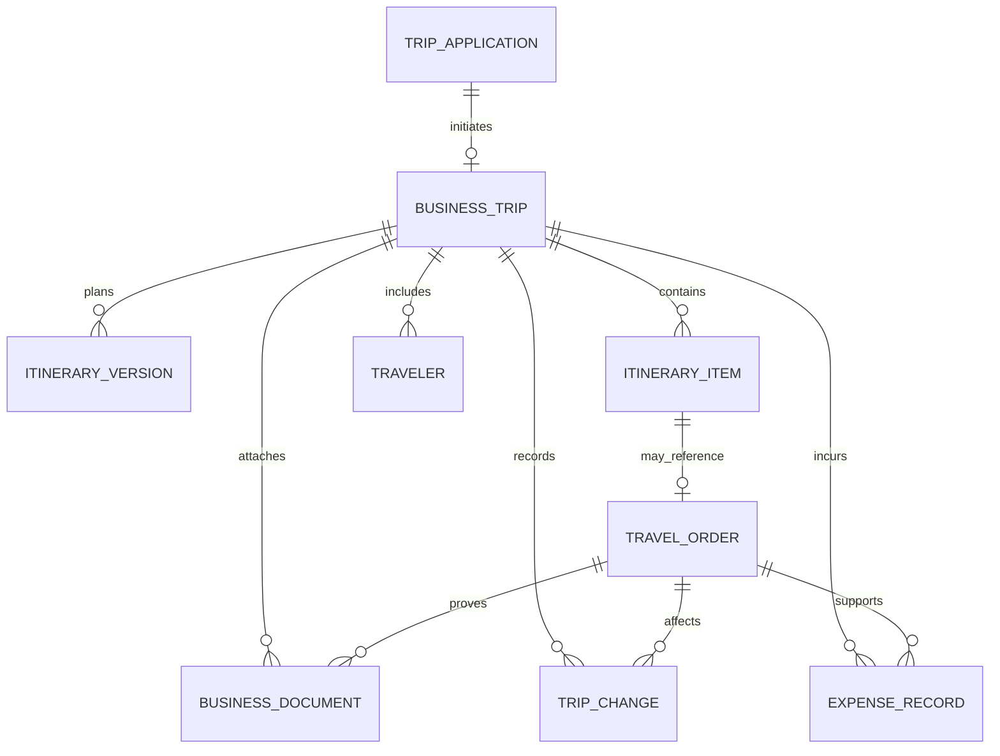

# 行程单管理领域模型

## 1. 建模目标与术语

行程单管理子智能体面向员工和差旅管理员，负责查找、解释和汇总已存在的出差行程及其关联订单。领域中需要区分“出差申请”“未预订方案”“正式行程单”“供应商订单”和“报销凭证”，它们代表不同业务事实，不能合并成一个含义模糊的“行程单”。

本文所说的**正式行程单**是一次出差的总览与容器，汇总出差人员、时间、地点、日程以及交通和住宿订单。机票票号、火车票、酒店确认号等仍属于各自的订单或凭证。

## 2. 单据分类

| 单据/记录 | 解决的问题 | 何时产生 | 是否属于正式行程单本身 |
| --- | --- | --- | --- |
| 出差申请单 | 谁因何事、在何时去哪里出差，是否获批 | 员工发起申请 | 否，是来源和审批依据 |
| 行程方案 | 出差如何安排，候选交通、住宿和日程是什么 | 申请获批后规划，或预订前 | 否，是可版本化的草案 |
| 正式行程单 | 一次出差的完整概览和执行进度 | 出差批准并进入规划/预订阶段后建立 | 是，聚合根 |
| 交通订单 | 航班、火车、长途汽车等实际预订及票务状态 | 预订成功或供应商返回订单 | 否，是行程单的组成项 |
| 住宿订单 | 酒店、企业协议住宿等预订及入住信息 | 预订成功 | 否，是行程单的组成项 |
| 地面交通记录/订单 | 接送机、租车、企业用车等城市内交通安排 | 预约或实际用车后 | 否，是可选组成项 |
| 日程事项 | 客户拜访、会议、培训等非供应商订单活动 | 行程规划或用户维护 | 否，是行程单的日程组成项 |
| 费用与报销记录 | 实际发生费用、报销状态和费用归属 | 出差过程中或结束后 | 否，与行程及订单关联 |
| 电子凭证/附件 | 电子客票、酒店确认单、发票、行程单 PDF 等文件 | 供应商或员工上传后 | 否，是关联文件 |

“行程单”在企业中也可能指航空公司提供的《航空运输电子客票行程单》（报销凭证）。系统应将该文件建模为 `TRAVEL_ITINERARY_RECEIPT` 一类附件，避免与本模型中的正式出差行程总览混淆。

## 3. 核心对象及关系

关系约束：

- 一个申请最多形成一个正式出差主记录；一次出差可有多个方案版本。
- 正式行程单由多名出差人、多段行程事项和多个订单组成；当前先支持一名员工，模型保留多人扩展能力。
- 一个交通行程段可关联一个或多个订单（例如联程航段）；酒店订单可覆盖多个入住晚数。
- 订单可能在供应商侧创建成功但本地同步失败，因此必须允许 `PENDING_RECONCILIATION`，不能只用成功/失败二态。
- 费用、发票和供应商凭证可关联出差主记录，也可进一步关联某个订单。
- 变更记录保存申请内容、用户确认、供应商执行结果及前后版本，不能只覆盖当前字段。

## 4. 建议的逻辑数据模型

下列为领域对象建议，不等同于立即执行的数据库 DDL。实际表结构需在确认业务流程、现有数据库和迁移方案后再确定。

### 4.1 正式出差 `business_trip`

一次出差的聚合根和查询入口。

| 字段 | 含义 |
| --- | --- |
| `id` / `trip_no` | 数据库主键 / 面向用户和外部系统的业务编号 |
| `application_id` / `application_no` | 来源申请；兼容线下或历史导入时允许为空 |
| `owner_user_id` / `organization_id` | 业务归属和组织范围，服务端鉴权依据 |
| `title` / `purpose` | 行程标题和出差事由 |
| `origin` / `primary_destination` | 起点和主要目的地；多城市详情放在行程事项中 |
| `start_at` / `end_at` | 整体出差时间，使用带时区的明确时间语义 |
| `status` | 出差总状态，不代替单项订单状态 |
| `version` | 并发更新版本 |
| `created_at` / `updated_at` | 创建和更新时间 |

建议出差状态：`DRAFT`、`AWAITING_APPROVAL`、`APPROVED`、`ARRANGING`、`READY`、`IN_PROGRESS`、`COMPLETED`、`CANCELLED`、`EXCEPTION`。具体状态须和申请、审批及预订流程统一后定稿。

### 4.2 出差人员 `trip_traveler`

| 字段 | 含义 |
| --- | --- |
| `trip_id` / `user_id` | 所属出差和员工标识 |
| `traveler_role` | `APPLICANT`、`TRAVELER`、`ASSISTANT` 等角色 |
| `display_name` / `employee_no` | 展示快照和员工编号 |
| `identity_reference` | 受控引用证件资料，不在行程查询结果中返回完整证件号 |

员工主数据是身份权威来源；必要的姓名/组织快照用于保留历史单据展示，敏感证件数据应通过单独授权服务访问。

### 4.3 行程方案 `itinerary_plan` 与版本

方案描述预期安排，不代表资源已预订。每次实质修改创建新版本，保存创建时间、来源和方案状态。已确认或已预订方案不可原地改写。

建议方案状态：`DRAFT`、`NEEDS_REVIEW`、`WAITING_CONFIRMATION`、`CONFIRMED`、`SUPERSEDED`、`EXPIRED`。

方案中的价格是带查询时间和有效期的报价快照，不是订单实付金额。

### 4.4 行程事项 `itinerary_item`

用统一顺序呈现一次出差的移动、住宿和日程；字段按类型解释，订单详情保存在独立订单记录中。

| 字段 | 含义 |
| --- | --- |
| `trip_id` / `plan_version_id` | 所属出差和可选方案版本 |
| `item_type` | `TRANSPORT`、`LODGING`、`GROUND_TRANSPORT`、`MEETING`、`TRAINING`、`OTHER` |
| `sequence_no` | 行程展示顺序 |
| `start_at` / `end_at` | 事项开始和结束时间 |
| `origin` / `destination` / `location` | 起终点或活动地点 |
| `status` | 事项本身状态，如计划、已确认、完成或取消 |
| `order_id` | 关联实际订单，可为空 |
| `description` | 必要的非敏感说明 |

交通事项还需记录交通方式、车次/航班号等展示字段；住宿事项需要入住/离店日期、酒店名称和地址。供应商价格、退改规则和支付状态不要塞入通用日程字段。

### 4.5 差旅订单 `travel_order`

保存企业系统和供应商共同确认的预订事实。

| 字段 | 含义 |
| --- | --- |
| `id` / `order_no` | 本地订单主键和业务订单号 |
| `trip_id` / `itinerary_item_id` | 所属出差和对应事项 |
| `order_type` | `AIR`、`RAIL`、`BUS`、`HOTEL`、`CAR`、`TRANSFER`、`OTHER` |
| `supplier_code` / `supplier_order_no` | 供应商及外部订单号 |
| `order_status` | 订单状态，与出差状态独立维护 |
| `amount` / `currency` | 金额使用十进制定点数并保存币种 |
| `booked_at` / `confirmed_at` | 下单和确认时间 |
| `change_policy_snapshot` | 下单时退改规则快照及来源时间 |
| `version` | 订单状态/内容版本 |

建议订单状态：`CREATING`、`CONFIRMED`、`CHANGE_PENDING`、`CANCEL_PENDING`、`CANCELLED`、`REFUND_PENDING`、`REFUNDED`、`FAILED`、`PENDING_RECONCILIATION`。不同订单类型可扩展类型明细，但状态转换由领域服务校验。

机票明细重点为乘机人、航段、航班号、起降机场、起降时间、舱等和票号；火车票明细为乘车人、车次、出发/到达站、时间、席别和票号；酒店明细为酒店、入住/离店时间、房型、间数、入住人和确认号。证件号和完整票号需按权限脱敏。

### 4.6 凭证 `business_document`

保存文件元数据和受控存储引用，不将文件二进制或敏感内容直接放入行程查询结果。

建议类型包括 `AIR_TICKET`、`TRAVEL_ITINERARY_RECEIPT`、`RAIL_TICKET`、`HOTEL_CONFIRMATION`、`INVOICE`、`BOARDING_PASS`、`OTHER`；记录关联出差/订单、文件存储键、上传来源、创建时间和访问级别。

### 4.7 变更记录 `trip_change`

改期、改签、退票、取消酒店等操作应形成单独变更单，关联原订单，保存变更原因、变更前后摘要、报价/费用差额、用户确认版本、幂等键、执行状态、供应商结果和操作者。变更记录是审计事实，不随订单当前状态更新而删除。

### 4.8 费用记录 `expense_record`

保存实际费用、费用类型、币种、发生日期、报销状态及发票引用；可关联 `trip_id` 和 `order_id`。报销审批与订单管理属于不同业务能力，行程单管理智能体只负责查询和汇总授权可见的报销信息。

## 5. 行程单管理子智能体的职责

### 可以负责

- 按当前登录用户和权限查询本人或授权范围内的行程单。
- 按时间、目的地、申请单号、行程单号、订单类型和状态筛选。
- 汇总某次出差的日期、地点、人员、日程、交通和住宿订单。
- 查询单项订单状态、供应商确认信息和状态更新时间，并明确标注数据来源。
- 展示关联的电子客票行程凭证、酒店确认单和已授权的费用/发票状态。
- 提醒缺失字段、临近出发、未确认订单、订单状态异常和待人工核查事项。
- 收集改签、取消或更新行程的需求，形成变更草案并确认影响范围。

### 必须委托领域服务或其他角色

- 申请审批状态、权限、政策和预算结论由对应领域服务提供。
- 实际创建/改签/取消供应商订单由预订订单服务执行；行程单管理 Agent 不直接改供应商订单。
- 任何写操作前，服务端重新校验用户权限、对象版本、政策和用户确认；Agent 的自然语言确认不能替代服务端确认令牌。
- 订单状态未知或供应商超时时，展示“待核查”，不得推断成功或失败。
- 删除采用业务取消/归档与审计，不物理删除已发生的订单和行程记录。

## 6. 查询视图建议

面向 Agent 的查询工具可先提供两个只读结构：

1. `TripSummary`：行程编号、标题、目的地、出差时间、总状态、人员摘要、事项计数、异常计数和最近更新时间。
2. `TripDetail`：`TripSummary` 加有序行程事项、订单摘要、关键凭证元数据、待处理事项和数据更新时间。

敏感字段默认脱敏；工具按当前认证主体过滤数据，不允许 Agent 传入任意 `userId` 扩大查询范围。单据多时采用分页或按时间分段，避免把完整历史一次注入模型上下文。

## 7. 典型用户表达及归属

| 用户表达 | 业务对象/动作 | 行程单管理 Agent |
| --- | --- | --- |
| “看看我下周去深圳的行程” | 查询正式出差及事项 | 查询并汇总 |
| “我的机票确认了吗？” | 查询交通订单状态 | 查询并说明来源和更新时间 |
| “把酒店确认单发我” | 访问关联凭证 | 鉴权后返回凭证引用或下载能力 |
| “我上次出差花了多少？” | 汇总授权费用记录 | 查询汇总；不替代报销审批 |
| “把周三的航班改到晚上” | 修改供应商订单 | 建立变更草案，确认后委托订单服务 |
| “帮我安排下周的出差行程” | 创建申请/规划新方案 | 转交申请和规划流程，不当作既有行程查询 |
| “提交出差申请” | 出差申请及审批 | 转交申请/审批能力 |
| “帮我订酒店” | 新预订 | 转交预订能力 |

## 8. 首期实现建议

首期先完成只读闭环：

1. 定义 `BusinessTrip`、`ItineraryItem`、`TravelOrder` 和 `BusinessDocument` 的只读 VO/工具输出契约。
2. 明确行程单数据的实际来源：企业自有差旅系统、供应商 API、导入数据或人工录入；在来源确定前不假设数据库表已存在。
3. 实现“我的行程列表、行程详情、订单状态和凭证列表”查询服务，统一按认证用户及组织权限过滤。
4. 将查询工具挂接到行程单管理子智能体，并确保查询结果有来源、更新时间和未知状态表达。
5. 再设计变更单、用户确认、幂等和供应商调用，最后开放改签/取消等写操作。

当前仓库还没有行程单、交通订单和酒店订单的领域表、Mapper 或业务服务，因此本文只是领域建模，不代表这些业务数据已经可以查询或修改。建库前需进一步确认供应商来源、员工/组织权限、多人出差、费用关联及历史数据迁移要求。
