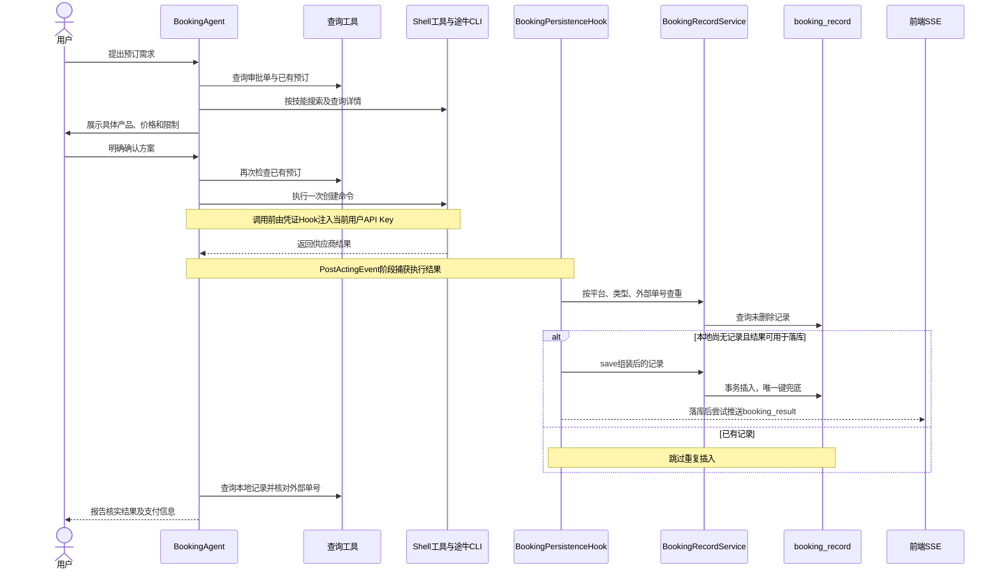
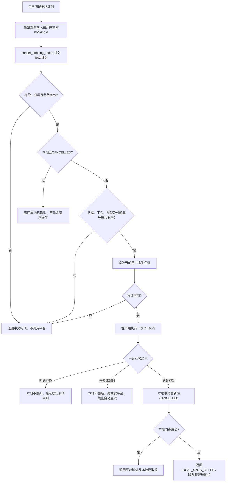

# 预订下单与取消持久化设计说明

本文根据当前 `BookingAgent`、`BookingPersistenceHook`、预订记录服务和取消工具的实际代码整理，说明下单与取消的业务流程、持久化原理及职责划分。实现基于 AgentScope 1.0.12；下文将提示词约定与后端已经执行的校验分别说明。

## 一、整体设计

当前预订能力围绕两个不同的入口组织：

- **下单：模型通过技能调用途牛 CLI，Hook 捕获工具返回结果，创建本地预订记录。** 正常链路不依赖模型再调用一次保存工具。
- **取消：模型只提供内部 `bookingId`，专用工具完成订单查询、归属校验、供应商取消和本地状态同步。** 供应商明确确认后，才更新本地状态。

两条链路最终都操作 `booking_record`，复用 `BookingRecordService` 的数据库访问和事务能力。当前链路不依赖 `BookingExecutionState`，用户与会话信息来自 `AgentRuntimeContext`，订单事实来自供应商响应和数据库记录。

| 组件 | 当前职责 |
| --- | --- |
| `BookingAgent` | 注册技能、Shell 工具、预订查询/写入工具及持久化 Hook，绑定会话上下文 |
| `BookingAgentPrompt.md` | 约定审批查询、重复检查、方案确认、下单后核实及取消入口 |
| `TuniuApiKeyShellHook` | 在 Shell 调用途牛前，按当前用户加载并注入凭证 |
| `BookingPersistenceHook` | 监听 Shell 完成事件，识别创建命令、解析响应并保存预订单，推送结果事件 |
| `BookingRecordReadTools` | 通过 `query_booking_records` 查询当前用户的本地预订记录 |
| `BookingRecordWriteTools` | 提供补存工具 `save_booking_record` 和取消工具 `cancel_booking_record`，返回中文可读结果 |
| `BookingCancellationService` | 编排取消校验、凭证读取、供应商调用及本地同步，区分失败、未知和部分成功 |
| `TuniuBookingCancellationClient` | 执行一次受控 CLI 取消，解析供应商业务结果 |
| `BookingRecordService` | 提供查重、插入、用户归属查询和本地取消状态更新 |

## 二、为什么下单用 Hook，取消用工具

### 2.1 下单 Hook 捕获已经发生的业务结果

当前下单入口是 `tuniu-cli` 技能配合 `execute_shell_command`。机票、酒店和火车票各有不同的创建命令与参数，供应商返回的订单号才是本地记录对应的真实外部标识。

在这个入口下，`PostActingEvent` 是合适的落库位置：Shell 工具已经执行完成，Hook 同时能够读取本次命令、工具返回结果以及当前用户上下文，可以直接把供应商结果转换为本地记录。

这样实现有三个主要原因：

1. **减少一次依赖模型的动作。** 如果完全要求模型在下单后调用保存工具，模型可能漏调、填错外部单号或重复保存。Hook 让正常落库成为工具执行后的系统行为。
2. **集中处理跨产品的公共逻辑。** 机票、酒店、火车票共享用户归属、外部单号去重、状态初始化、数据库插入和前端通知，只将参数映射按产品区分。
3. **直接使用执行结果。** 持久化依据是工具输出，而非模型在自然语言答复中声称“预订成功”。

Hook 是事后处理，不能保证供应商请求一定只发生一次，也不能回滚已经创建的供应商订单。当前实现会在 Hook 异常时记录日志并返回原事件，所以还需要下单后查询核实和缺失记录补存。

这里的“事后”指工具执行后的 Hook 阶段，当前没有接入消息队列或后台补偿任务；不能将其理解为已有可靠的异步投递机制。

### 2.2 取消工具主动执行一次完整操作

取消面对的是数据库中一笔已经存在的预订单。系统可以从内部 `bookingId` 查出归属、平台、业务类型和真实供应商订单号，再决定是否允许执行以及执行哪个命令。

将这些步骤收口到 `cancel_booking_record`，可以保证：

1. **先校验权限，再访问供应商。** 用户身份从会话注入，模型只提供 `bookingId`，不能自行指定其他用户、凭证或外部订单号。
2. **把平台取消和本地同步放入同一条业务编排。** 工具知道平台是否明确成功，也能知道本地更新是否成功，从而给出准确结果。
3. **统一状态规则及异常提示。** 已取消、不可取消、平台不支持、凭证缺失、超时和本地同步失败都有明确分支。
4. **避免模型分别拼接多个有副作用的步骤。** 模型无需先执行 Shell 取消，再依靠另一次工具调用或 Hook 猜测本地是否应更新。

当前取消客户端通过 `ProcessBuilder` 在 Java 服务内部执行 CLI，不会生成一次 Agent 的 `execute_shell_command` 调用，因此也不会由下单 Hook 自动接管。Hook 虽保留取消命令识别分支，但 `handleCancel` 当前没有实现取消持久化逻辑。

这是一种基于当前入口的职责选择，并非框架要求“下单只能用 Hook、取消只能用工具”。如果以后把下单也收口为专用 Java 工具，同样可以由服务统一完成创建和持久化。

| 对比项 | 下单链路 | 取消链路 |
| --- | --- | --- |
| 模型提供的业务输入 | 技能要求的产品、乘客、联系人等下单参数 | 内部 `bookingId` |
| 供应商调用入口 | Agent 的 Shell 工具 | Java 取消客户端 |
| 本地持久化入口 | 工具完成后的 Hook | 取消服务在供应商确认后调用本地服务 |
| 主要事实来源 | CLI 创建结果及本次命令参数 | 当前用户的数据库记录及 CLI 取消结果 |
| 本地写入失败的反馈 | Hook 放行原结果，随后查询核实 | 直接返回 `LOCAL_SYNC_FAILED` 部分成功结果 |

## 三、预订记录与三个订单标识

| 字段 | 含义与用途 |
| --- | --- |
| `id` | 数据库自增主键，供内部存储使用 |
| `booking_id` / `bookingId` | 应用内部预订单号，查询和取消工具使用此标识 |
| `external_order_no` / `externalOrderNo` | 供应商返回的订单号，调用途牛取消时作为 `orderId` |
| `user_id` | 预订单归属，查询和取消必须按当前会话用户过滤 |
| `conversation_id` | 关联创建订单的会话，Hook 从运行时上下文取得 |
| `travel_order_id` | 关联差旅申请单；当前 Hook 创建路径尚未赋值，见后文实现边界 |
| `biz_type`、`platform` | 区分产品类型及供应商，参与外部订单唯一性判断 |
| `status`、`payment_status`、`external_status` | 分别表达统一业务状态、支付状态和外部状态，不能互相替代 |
| `detail` | 当前保存下单参数和解包后的供应商结果，供追溯使用 |

当前 Hook 显式生成标准 UUID 字符串作为 `bookingId`。`BookingRecordService.save` 仅在调用方未提供时补生成 `BK` 前缀单号；补存使用的 `create` 也生成 `BK` 前缀单号。因此调用取消工具时应使用查询返回的实际值，不能根据前缀猜测订单。

数据库有两条关键唯一约束：

```sql
UNIQUE KEY uk_booking_id (booking_id)
UNIQUE KEY uk_platform_order (platform, biz_type, external_order_no)
```

应用先查重，数据库再兜底，避免同一平台、同一类型、同一外部订单重复落库。查重条件没有 `userId`，这是内部使用的供应商订单唯一性判断；面向用户的查询与取消仍按用户归属过滤。

## 四、完整预订下单流程

### 4.1 业务流程与模型约定

当前提示词要求按以下顺序执行：

1. 调用 `query_trip_orders` 查询当前用户审批通过的差旅单；没有 `APPROVED` 申请单时停止预订。
2. 让用户选择关联申请单，再调用 `query_booking_records` 检查同类产品、日期和状态，避免重复预订。
3. 读取 `tuniu-cli` 对应产品资料，确认实际可用命令、必填字段及真实产品标识来源。
4. 读取当前用户资料，搜索并比较产品；向用户展示产品、日期、人数、价格及限制，等待对具体方案的明确确认。
5. 用户确认后再次查询预订记录；确认没有对应有效订单后，只执行一次供应商创建命令。
6. Hook 尝试自动落库。模型随后查询本地记录，核对外部订单号，再向用户报告结果。
7. 仅当供应商已确认创建、查询成功且确实缺少本地记录时，使用 `save_booking_record` 补存；状态不明时先核实，不能重新下单。

审批检查、方案确认和上述调用顺序目前主要由提示词约束。不能把这些约定等同于 Hook 已经实现审批校验或供应商侧并发下单锁。



### 4.2 Hook 如何识别和转换结果

Hook 仅处理 `PostActingEvent` 中名为 `execute_shell_command` 的工具调用，从 `input.command` 识别下列创建命令片段，比较时忽略大小写：

| 业务类型 | 当前识别的命令片段 |
| --- | --- |
| `FLIGHT` | `call flight saveOrder` |
| `HOTEL` | `call hotel tuniuHotelCreateOrder` |
| `TRAIN` | `call train bookTrain` |

随后按以下步骤处理：

1. 从 Reactor Context 的 `agentRuntimeContext` 读取用户、会话信息；缺少有效用户时跳过同步。
2. 从 `ToolResultBlock` 提取文本并解析 JSON，兼容 Shell 输出包装；读取 `result`，解包 MCP 的 `content[].text`，兼容对象和 JSON 字符串。
3. 优先从非空 `data` 提取订单信息，否则使用解包后的结果；按 `orderId`、`orderNo`、`mainOrderNo`、`bookingOrderId`、`order_id` 等名称取外部单号。
4. 调用 `findByExternalOrder("tuniu-cli", bizType, externalOrderNo)`，已存在时直接结束。
5. 创建实体，写入用户、会话、内部单号、外部单号、类型、平台和下单时间；初始化 `status=CREATED`、`paymentStatus=UNPAID`。
6. 从命令 `-a` 的 JSON 参数补充标题、联系人、时间和金额；将 `args`、解包后的 `result` 放入 `detail`。
7. 调用 `bookingRecordService.save(bookingRecord)` 插入数据库，再尝试推送 SSE 事件。

参数补充按产品分别处理：机票读取城市、航班和联系人；酒店读取酒店名称、入住/离店日期和联系人；火车票读取资源日期、价格和联系电话。字段缺失时可能保留为空，当前不保证所有产品都能取得完整标题和总价。

`save` 校验用户、类型、平台、明细 JSON 和起止时间，设置缺省币种 `CNY`、逻辑删除标记等，在本地事务中插入。数据库唯一键处理并发查重后仍同时插入的情况；冲突会被转换为业务异常，再由 Hook 捕获。

**当前成功判定的实际边界：** `handleCreate` 仅显式跳过外层 `success=false`，尚未在主路径严格核验所有内层业务成功标志。文件中虽然存在递归失败检查辅助方法，当前创建路径没有调用。提示词要求核实真实成功和外部单号，但不能据此认为 Hook 已完成同等强度的验证。

### 4.3 下单后的前端通知与补存

落库后 Hook 尝试发送名为 `booking_result` 的 SSE 事件，包含产品类型、外部 `orderId`、标题、金额、币种、支付或详情链接及“待支付”展示文案。当前事件不包含内部 `bookingId`，该值可通过预订记录查询获得。

没有活动 SSE 连接或发送失败时，前端可能收不到事件；SSE 发送失败不会撤销已经插入的记录。重复结果被查重跳过时，也不会再次执行这一推送。

`save_booking_record` 是本地记录补存入口，不会向供应商重新下单。正常情况下，模型查询到 Hook 已创建的记录后无需再保存。Hook 解析或数据库写入失败时，原工具结果仍可能成功，所以必须区分“供应商已创建”与“本地已保存”，再决定补存或人工核实。

## 五、完整取消流程

### 5.1 对模型开放的入口

用户明确要求取消后，模型先查询本人预订记录、核对目标订单，再调用：

```json
{
  "bookingId": "8e6c08f7-3baa-4f68-9a69-65f31a6b0d24"
}
```

以上为虚构标识示例。工具名为 `cancel_booking_record`，唯一需要模型填写的参数是 `bookingId`。`AgentRuntimeContext` 由 `ToolExecutionContext` 注入，模型无需提供 `userId`、外部订单号或 API Key，也不应另外执行 Shell 取消命令。

### 5.2 服务内部的执行顺序

1. **校验身份和参数。** 用户不能为空，`bookingId` 去除首尾空白后不能为空且长度不超过 64。
2. **先查归属。** 按当前用户和 `bookingId` 查询未删除记录，并核对返回数据。不存在或属于他人统一返回未找到，不获取凭证、不调用供应商。
3. **检查本地状态。** 已为 `CANCELLED` 时直接返回，本次不重复请求途牛，也不声称重新核实了平台。其他记录仅允许 `CREATED`、`PENDING_PAYMENT`、`PAID`、`CONFIRMED` 继续。
4. **检查支持范围。** 平台仅接受 `tuniu-cli` 或 `tuniu`，产品仅支持 `FLIGHT`、`TRAIN`；酒店及其他平台通过对应渠道处理。
5. **检查外部单号。** 使用数据库保存的 `externalOrderNo`，缺失时停止，不能让模型猜测补齐。
6. **加载当前用户凭证。** 调用 `ProviderApiKeyService.getActiveApiKey(userId, "TUNIU")`。凭证服务读取有效记录并完成解密；缺失或读取失败时返回中文提示，本次不向平台发起取消。
7. **调用一次供应商取消。** 客户端固定选择机票或火车票 `cancelOrder`，不自动重试。
8. **核实供应商业务结果。** 明确拒绝或结果未知时，不更新本地记录；只有 `CONFIRMED` 才继续。
9. **同步本地状态。** 调用 `BookingRecordService.cancel(userId, bookingId)`，在本地事务内更新为 `CANCELLED`。
10. **返回完整结果。** 分别表达供应商是否确认取消、本地是否确认已取消；本地失败时返回部分成功及管理员处理建议。



### 5.3 客户端如何执行并核实取消

客户端的逻辑命令如下，订单号来自数据库，凭证不放入参数：

```text
tuniu call flight cancelOrder -a '{"orderId":"<供应商订单号>"}' -t 45
tuniu call train cancelOrder -a '{"orderId":"<供应商订单号>"}' -t 45
```

实现使用 `ProcessBuilder` 参数列表传递 JSON。Windows 下寻找 npm 安装的 `tuniu.js` 并直接通过 Node 运行，避免经 `cmd` 二次解释参数。

凭证只设置到本次子进程环境：`TUNIU_API_KEY`、`TUNIU_AUTH_TYPE=apiKey`、`TUNIU_AUTH_SOURCE=tuniu-cli`。这样既隔离不同用户，也明确要求 CLI 使用当前用户 API Key，避免复用宿主机已有 OAuth 身份。客户端不将凭证、原始响应或错误输出返回模型。

进程等待上限为 60 秒，CLI 自身参数为 `-t 45`；stdout 和 stderr 并行消费，stdout 限制为 1 MiB。超时、中断、输出不完整或无法解析均作为结果未知，不等同于平台取消失败。

**退出码为 0 只表示 CLI 执行完成，仍需核实内层业务结果。** 客户端沿 `result`、`structuredContent`、`content[].text` 包装解析，兼容 `text` 为对象或 JSON 字符串，限制嵌套深度。解析到 `success=false`、`successCode=false` 或 `isError=true` 时，明确失败优先；叶子业务结果的 `success=true` 或 `successCode=true` 才作为确认依据。

例如火车票的 `{"successCode":true,"data":0}` 可以表示成功，不能仅因 `data=0` 判失败。缺少可识别的业务确认时返回 `UNKNOWN`。

### 5.4 本地更新与事务边界

`BookingRecordService.cancel` 只负责本地同步，本身不请求途牛。它在一条更新语句内同时限制用户、内部单号、未删除标记及状态，排除 `CANCELLED`、`COMPLETED`、`REFUNDED`，防止并发操作把已完成或已退款记录覆盖成取消。

更新成功时设置 `status=CANCELLED` 和 `updated_at`；不删除预订单，也不自动改写 `payment_status` 或 `external_status`。未更新时再查本人记录：已经取消仍返回成功，其他不允许情况返回状态错误。上层取消服务的状态白名单比这个本地方法更严格，不能绕过上层服务来代表平台取消。

供应商调用不包在数据库长事务中：网络等待不能长期占用数据库事务，而且供应商已经完成的取消也无法通过本地事务回滚。因此采用“先平台确认，再本地事务更新”的顺序，并明确返回两段结果。

## 六、结果语义与对模型友好的异常处理

取消工具返回 `success`、`errorCode`、中文 `message`、`data` 和 `cancelledAt`。`data` 中的三个字段需要一起理解：

- `providerCancelled`：`true` 表示本次平台明确确认取消；`false` 表示本次调用被明确拒绝或执行前置失败；`null` 表示未调用或未确认，不能据此推断平台订单状态。
- `localUpdated`：本地已确认处于取消状态；已经取消的幂等返回也可以为 `true`，不表示本次一定执行了更新语句。
- `status`：能够确认的本地状态；本地同步失败时返回 `null`，避免伪造 `CANCELLED`。

| 情况 | `success` | `providerCancelled` | `localUpdated` | 后续处理 |
| --- | --- | --- | --- | --- |
| 供应商确认且本地同步成功 | `true` | `true` | `true` | 报告取消完成，退款另行核实 |
| 本地原本已取消 | `true` | `null` | `true` | 不重复请求；平台状态与退款另行查询 |
| 参数、归属、状态或凭证校验未通过 | `false` | `null` | `false` | 按中文提示修正；未发起供应商取消 |
| 供应商明确拒绝或 CLI 鉴权/配置被拒绝 | `false` | `false` | `false` | 核实凭证、环境或平台取消规则 |
| 超时、输出不完整、无法确认结果 | `false` | `null` | `false` | 先查询平台实际状态，不自动重试 |
| 平台已取消、本地同步失败 | `false` | `true` | `false` | `LOCAL_SYNC_FAILED`，交管理员同步本地状态 |

`null` 字段在 JSON 序列化时可能被省略；字段缺失同样不能解释为平台已确认。`cancelledAt` 只是本次操作时间，失败结果中也会存在，不能据此证明取消完成。取消完成更不代表退款完成或到账。

工具和服务通过捕获异常返回业务结果，不把堆栈、SQL、解密错误或第三方原始错误直接暴露给模型。例如：

> 途牛已确认取消，但本地记录更新失败；请联系管理员同步状态，不要再次向途牛发起取消。

> 途牛取消结果尚未确认，可能超时或响应不完整；本地记录保持原状态，请先查询平台实际状态，不要自动重试取消。

这些提示同时说明已知事实、尚未完成的步骤以及下一步动作，避免模型将技术异常解释为取消成功，或因异常盲目重复执行。

## 七、一致性保障与当前实现边界

1. **本地去重不等于供应商下单幂等。** `findByExternalOrder` 和唯一键只能阻止同一外部单号重复落库，不能阻止平台创建两个不同订单。下单前查询和用户确认仍然必要，超时后应核实平台。
2. **逻辑删除不释放外部订单唯一键。** 查询排除 `deleted=1`，但唯一索引不包含 `deleted`；已逻辑删除的同一订单不能按新记录直接重插，需要明确恢复或修复策略。
3. **当前没有跨平台与数据库的分布式事务。** Hook 落库失败需要查询和补存；取消本地同步失败需要管理员处理。目前没有自动补偿队列或持久化重试任务。
4. **取消的重复调用保护有范围。** 本地已取消后再次调用不会重复请求平台；但并发请求都读到旧状态时，当前没有分布式锁保证平台只收到一次取消请求。
5. **审批关联尚未完整落地。** 提示词要求关联审批通过申请单，但当前 Hook 只设置 `conversationId`，未自动设置 `travelOrderId`，也未在创建路径执行后端审批校验。不能假设按差旅单筛选一定能查到 Hook 创建的记录。
6. **下单结果校验仍需加强。** 当前创建路径的外层成功过滤比取消客户端的内层业务校验宽松；两者不能视为已经统一。
7. **当前明细保存原始数据。** 创建路径把参数和结果直接写入 `detail`，没有调用文件中的脱敏辅助方法。明细可能含个人信息，不能把“存在脱敏方法”理解为主路径已经脱敏；后续应明确字段最小化和访问范围。
8. **当前没有双表同步。** 虽然 Hook 仍注入 `TripBookingRecordService`，部分注释也提及两类记录，但实际 `handleCreate` 只保存 `booking_record`，`handleCancel` 为空，不能认为同时完成 `trip_booking_record` 的预占与状态同步。

上述边界依据当前方法调用路径整理，后续实现调整时，应同步更新本文中的流程和结果语义。

## 八、源码索引

| 入口或实现 | 文件 |
| --- | --- |
| 智能体注册 | [BookingAgent.java](/E:/code/agent/CorpTripAgent/src/main/java/cn/lwccxy/trip/agent/BookingAgent.java) |
| 模型工作流程约定 | [BookingAgentPrompt.md](/E:/code/agent/CorpTripAgent/src/main/resources/sysprompt/BookingAgentPrompt.md) |
| 会话上下文传递 | [ChatAgentPipeline.java](/E:/code/agent/CorpTripAgent/src/main/java/cn/lwccxy/trip/business/chat/ChatAgentPipeline.java) |
| 下单持久化 Hook | [BookingPersistenceHook.java](/E:/code/agent/CorpTripAgent/src/main/java/cn/lwccxy/trip/agent/hooks/BookingPersistenceHook.java) |
| Shell 凭证注入 | [TuniuApiKeyShellHook.java](/E:/code/agent/CorpTripAgent/src/main/java/cn/lwccxy/trip/agent/hooks/TuniuApiKeyShellHook.java) |
| 本地预订查询工具 | [BookingRecordReadTools.java](/E:/code/agent/CorpTripAgent/src/main/java/cn/lwccxy/trip/agent/tools/BookingRecordReadTools.java) |
| 补存及取消工具 | [BookingRecordWriteTools.java](/E:/code/agent/CorpTripAgent/src/main/java/cn/lwccxy/trip/agent/tools/BookingRecordWriteTools.java) |
| 取消业务编排 | [BookingCancellationService.java](/E:/code/agent/CorpTripAgent/src/main/java/cn/lwccxy/trip/business/bookingrecord/service/BookingCancellationService.java) |
| 途牛取消客户端 | [TuniuBookingCancellationClient.java](/E:/code/agent/CorpTripAgent/src/main/java/cn/lwccxy/trip/business/bookingrecord/integration/TuniuBookingCancellationClient.java) |
| 本地持久化与状态更新 | [BookingRecordService.java](/E:/code/agent/CorpTripAgent/src/main/java/cn/lwccxy/trip/business/bookingrecord/service/BookingRecordService.java) |
| 取消结果模型 | [BookingCancellationVO.java](/E:/code/agent/CorpTripAgent/src/main/java/cn/lwccxy/trip/business/bookingrecord/domain/vo/BookingCancellationVO.java) |
| 初始化表结构 | [init.sql](/E:/code/agent/CorpTripAgent/sql/init.sql) |
