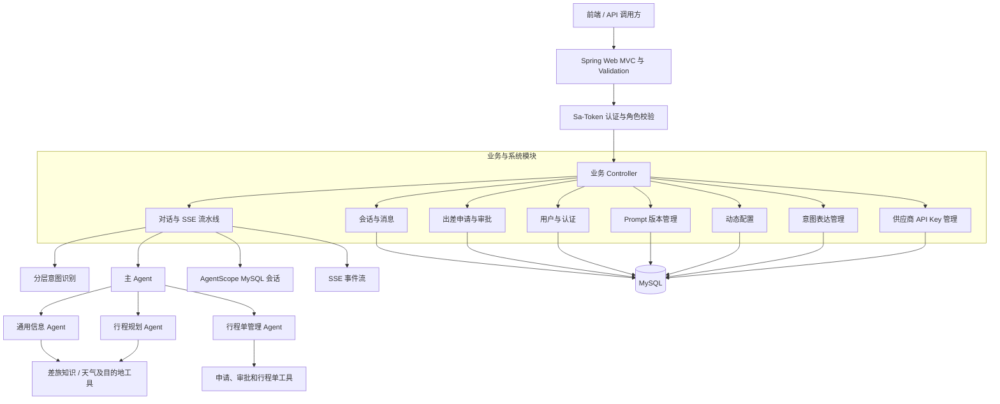

# CorpTripAgent

面向企业内部差旅场景的智能出差助手后端。项目希望让员工通过自然语言完成差旅咨询、申请和行程规划，并在审批、用户确认和权限校验等边界内逐步扩展到预订与行程管理。

> 当前项目处于持续开发阶段。下文区分已经在代码中落地的功能与仍在规划的能力；“已实现”不代表已连接真实机票、酒店等供应商，也不代表已经达到生产部署要求。

## 项目背景

企业差旅流程通常分散在制度查询、申请审批、交通住宿规划和订单管理等环节。CorpTripAgent 将对话式 Agent 与确定性的后端业务服务结合：大模型负责理解表达、组织信息和调用工具，服务层负责用户身份、数据归属、状态流转与持久化。涉及审批和外部订单的动作保留人工决策与确认边界。

## 当前实现

- 用户注册、登录、登出、当前用户信息、密码修改，以及管理员用户查询和密码重置审计。
- 会话创建、列表和详情查询、重命名、消息历史分页、反馈，以及基于 SSE 的流式 Agent 对话和澄清后恢复。
- 多层意图识别：规则与子句拆分、向量召回、模型兜底和多意图路由，并支持维护意图表达。
- AgentScope 主智能体与通用信息、行程规划、行程单管理子智能体；支持工具执行进度推送、会话持久化、上下文管理和 Token 用量估算。
- 企业差旅指南、差旅政策知识检索；目的地实时信息工具、天气 MCP 接入和旅行平台 Skill 配置。
- 出差申请创建后进入管理员待审批队列；支持申请/审批记录查询及管理员批准或驳回。状态更新由事务控制。
- 行程规划目前生成候选方案并结合可用的目的地、天气信息，不查询实时交通/住宿库存，也不下真实订单。
- Prompt 定义、版本、版本比较、发布、下线、回滚和发布审计；动态配置管理及缓存重载。
- 用户第三方旅行平台 API Key 的加密存储与管理接口。

## 架构设计

项目采用单模块 Maven 单体后端，按 Controller、Service、Mapper、Entity 分层。HTTP 接口使用统一响应对象，输入输出分别通过 Form 和 VO 表达。



### 分层职责

| 层 | 职责 |
| --- | --- |
| Controller | 接收 HTTP 请求、校验 Form、返回 `Response` 或 `PageResponse`；聊天接口提供 SSE。 |
| Service | 承担领域校验、用户数据归属、事务和状态流转。 |
| Mapper / Entity | 使用 MyBatis-Plus 访问并映射 MySQL 数据。 |
| Agent | 负责自然语言理解、任务拆分和工具选择；工具调用仍由后端服务校验权限和业务状态。 |
| 公共设施 | Sa-Token 认证、统一异常响应、运行时 Agent 上下文、SSE 推送和模型用量统计。 |

### 主要模块

| 模块 | 代码位置 | 主要职责 |
| --- | --- | --- |
| 智能体与对话 | `agent/`、`business/chat/` | 主/子 Agent、分层意图识别、工具、Hook、SSE 和 Agent 运行配置。 |
| 会话管理 | `business/conversation/` | 会话与消息持久化、历史分页、反馈和会话元数据。 |
| 差旅申请与审批 | `business/trip/` | 申请单及审批记录、管理员待办和审批状态流转。 |
| 意图表达 | `business/intent/` | 维护意图口语表达，为向量召回提供数据。 |
| 用户与认证 | `system/user/` | 注册登录、凭据管理、用户管理及重置审计。 |
| Prompt 管理 | `system/prompt/` | Prompt 版本、发布状态、回滚和审计。 |
| 动态配置 | `system/config/` | 配置查询、变更和服务内缓存同步。 |
| 供应商密钥 | `business/apikey/` | 当前用户的第三方平台 API Key 管理和加密存储。 |

### 关键对话链路

1. 客户端通过 `/chat/chat` 提交消息；服务端校验并保存用户消息，创建本轮 Agent 运行上下文。
2. 意图识别组合规则、历史上下文、向量知识和模型结果，生成路由提示。
3. 主 Agent 按需调用已注册的子 Agent 或工具；业务工具通过当前认证上下文获取用户身份。
4. SSE 推送回答增量、工具进度、澄清请求和终态事件；用户回复澄清后可通过 `/chat/resume` 恢复。
5. 会话和 AgentScope 运行状态写入 MySQL。差旅申请和审批状态由后端服务校验并持久化。

## 技术栈

| 类别 | 技术 |
| --- | --- |
| 语言与运行时 | Java 21 |
| Web 框架 | Spring Boot 3.5.6、Spring Web、Jakarta Validation |
| Agent | AgentScope 1.0.12、ReAct Agent、MCP、RAG、Skill、Hook |
| 数据访问 | MyBatis-Plus 3.5.9 |
| 数据库与连接池 | MySQL、MySQL Connector/J、Druid 1.2.23 |
| 认证与安全 | Sa-Token 1.39.0、Spring Security Crypto |
| 序列化与代码辅助 | Fastjson2 2.0.43、Lombok 1.18.30 |
| 构建与测试 | Maven、Spring Boot Test、JUnit |

模型、嵌入、天气 MCP、目的地信息和旅行 Skill 等外部能力需要相应服务与凭据；具体可用性取决于本地环境配置。

## 数据与运行状态

初始化脚本位于 `sql/init.sql`，已有环境的迁移脚本位于 `sql/migration/`。主要数据包括用户、会话消息、AgentScope 会话、Prompt 及其版本和发布记录、动态配置、意图表达、第三方平台密钥、出差申请和审批记录。

AgentScope 对话会话使用 MySQL 持久化。RAG 知识索引当前由内存存储构建；动态配置缓存和部分运行时状态是单实例范围，多实例部署前需要补齐共享缓存/会话策略及同步机制。

## 技术栈与本地运行

### 环境要求

- JDK 21
- Maven 3.9+
- MySQL，并创建项目使用的数据库
- 按需要配置模型服务、向量嵌入、天气 MCP 和目的地信息服务凭据

### 启动步骤

1. 创建本地配置文件 `src/main/resources/config/application-local.yml`，参考 [`application-example.yml`](src/main/resources/config/application-example.yml) 填写数据库、Redis、模型和外部服务配置。不要把真实密码或 API Key 提交到仓库。
2. 创建数据库并执行 [`sql/init.sql`](sql/init.sql)。已有数据库升级时，先核对当前版本，再按顺序评估并执行对应的 `sql/migration/` 脚本。
3. 使用 Java 21 构建并启动：

   ```bash
   mvn test
   mvn -DskipTests compile
   mvn spring-boot:run
   ```

默认服务端口为 `8080`。具体外部服务配置项以 `application-example.yml` 及对应配置类为准。

## 主要接口

接口受认证和角色规则约束，以下是按 Controller 路径归纳的入口，具体请求体以对应 Form 为准。

| 路径 | 用途 |
| --- | --- |
| `/auth` | 注册、登录、登出、当前用户、修改密码。 |
| `/chat` | SSE 对话和澄清后恢复。 |
| `/agent/conversations` | 会话及消息历史管理。 |
| `/trip/orders`、`/trip/approval-records` | 当前用户的出差申请和审批记录。 |
| `/admin/trip/approval-records` | 管理员查询待办、审批申请。 |
| `/system/user` | 管理员用户查询和密码重置。 |
| `/system/prompt` | Prompt 与版本发布管理。 |
| `/config` | 动态配置管理。 |
| `/intent/utterances` | 意图表达管理。 |
| `/provider-api-keys` | 当前用户的第三方 API Key 管理。 |

## 仍待实现或完善

- 接入真实机票、火车票和酒店搜索、报价、库存与订单适配器；目前旅行平台 Skill/MCP 配置不等同于完整供应商订单闭环。
- 完善出差政策、预算与组织规则的结构化校验，并将规则校验从提示词约束推进到可测试的确定性服务。
- 建立完整的“申请审批 -> 方案确认 -> 预订 -> 行程单 -> 变更/取消 -> 出差结束与报销归档”业务闭环。
- 将行程规划方案结构化并持久化，支持方案版本、实时资源比较、用户确认和预订前复核。
- 完善供应商调用的幂等、超时对账、部分成功恢复、操作审计和人工介入机制。
- 评估并增强意图识别准确率、澄清体验、Agent 工具边界和故障恢复能力。
- 多实例部署前完善 Sa-Token 会话共享、配置缓存同步、RAG 索引持久化、密钥轮换与监控告警。
- 增加端到端接口验证、真实 MySQL 迁移验证及外部服务失败场景测试；当前测试主要覆盖服务、认证、意图、工具与部分集成逻辑。

以上是按当前代码可见范围整理的后续方向，不代表所有事项都已有排期。

## 项目文档

- [整体架构说明](doc/architecture-overview.md)
- [智能差旅 Agent 设计](doc/intelligent-travel-agent-design.md)
- [多智能体架构](doc/multi-agent-architecture.md)
- [意图识别架构与指标记录](doc/意图识别架构与指标记录.md)
- [Agent SSE 进度事件协议](doc/agent-progress-timeline.md)
- [数据库初始化脚本](sql/init.sql)

## 安全说明

请仅使用自己的本地或部署环境凭据，并通过未纳入版本控制的配置或安全的密钥管理方式注入。公开到 GitHub 前请检查新增及历史提交中的 Token、API Key、数据库密码和第三方服务地址凭据；若真实密钥曾进入 Git 历史，应立即在对应平台轮换，单纯从当前文件删除不足以撤销已暴露凭据。
